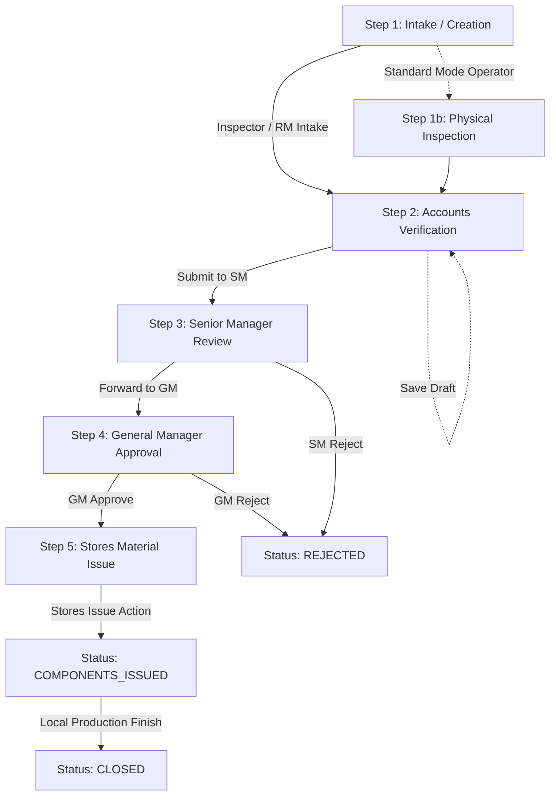
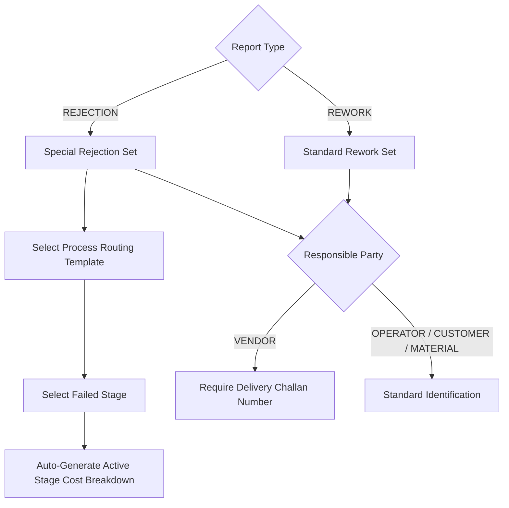
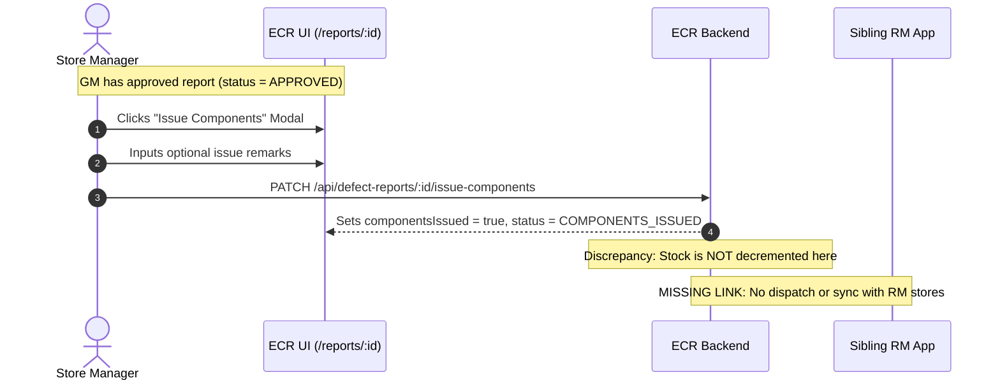
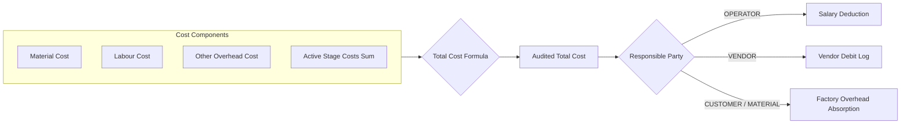
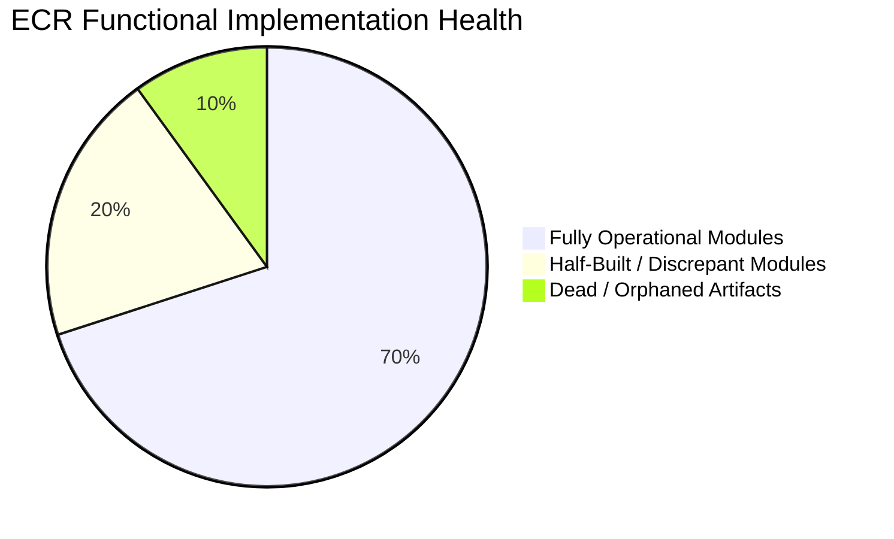

# Enterprise Quality Report (ECR) System — Business Flow & Integration Specification

**Document Version:** 1.0.0  
**Target Application:** Velan Enterprise Quality Report (ECR) Digitization System (`ecr-system` / `frontend`)  
**Scope:** Complete business workflow analysis, operational roles, screens, field maps, stock/cost touchpoints, notification matrix, and sibling-app integration readiness.  
**Audience:** Business Analysts, Product Managers, Solution Architects, Integration Developers.  
**Constraint Compliance:** Read-only audit; citations provided for all claims (`filepath#Lline` or symbol); no code modified; unverified data recorded as `UNKNOWN`.

---

## 1. Executive Purpose & Daily Users

The **Enterprise Quality Report (ECR)** application (branded as the *Velan Quality Hub*) serves as the centralized digital record and approval authority for manufacturing defects, non-conforming parts, component reworks, and scrap rejections across production lines and vendor dispatches (`frontend/src/components/layout/Sidebar.jsx#L15-L21`). Its primary business mission is to replace manual paper defect slips with a strict, auditable 5-tier financial and managerial gatekeeping process that calculates stage-by-stage labor and material losses, verifies financial impact before repair or scrap disposal, holds responsible parties accountable (via automated salary deduction or vendor debit recovery), and authorizes warehouse stores to issue replacement components (`ecr-system/src/defect-reports/defect-reports-workflow.service.ts#L324-L390`, `ecr-system/src/notifications/status-notification.handler.ts#L184-L205`).

### Daily Operational Users
*   **Machine Operators:** Production floor personnel who identify physical component anomalies, defective cuts, or machining errors and log initial incident reports (`ecr-system/src/users/user.entity.ts#L7-L15`, `frontend/src/pages/dashboards/OperatorDashboard.jsx#L1-L72`).
*   **Quality Control (QC) Inspectors:** Technical specialists who verify physical defects, classify non-conformities into Rework or Rejection, pinpoint the manufacturing stage of failure, record responsible operators or vendors, and establish baseline recovery estimates (`ecr-system/src/defect-reports/dto/inspect-report.dto.ts#L23-L64`, `frontend/src/pages/dashboards/InspectorDashboard.jsx#L1-L159`).
*   **Cost & Accounts Executives:** Financial gatekeepers who audit material loss, calculate labor rates, record machining overheads, confirm net loss amounts, and formally certify the financial exposure of the incident (`frontend/src/pages/dashboards/AccountsDashboard.jsx#L1-L100`, `frontend/src/pages/ReportDetailPage.jsx#L124-L227`).
*   **Senior / Section Managers (SM):** Production and operational leaders who investigate systemic loopholes, detect operational biases or conflicts of interest, make correction decisions, and advance reports to executive leadership (`ecr-system/src/defect-reports/dto/sm-review.dto.ts#L5-L26`, `frontend/src/pages/ReportDetailPage.jsx#L1223-L1274`).
*   **General Manager (GM):** Executive authority who reviews total financial losses and management notes to grant final approval for component replacement and scrap disposal, or rejects non-compliant claims (`ecr-system/src/defect-reports/dto/gm-approve.dto.ts#L5-L16`, `frontend/src/pages/ReportDetailPage.jsx#L1275-L1308`).
*   **Store / Warehouse Managers:** Inventory custodians who receive digital dispatch authorizations upon GM approval to physically issue replacement raw materials or finished components to production (`ecr-system/src/component-issue/component-issue.controller.ts#L16-L23`, `frontend/src/pages/ReportDetailPage.jsx#L1309-L1314`).
*   **Quality & Plant Administrators:** System custodians who manage user access, configure master component lists, process cost templates, monitor background email delivery, and conduct forensic audit trail reviews (`ecr-system/src/users/users.controller.ts#L18-L45`, `frontend/src/pages/MasterDataPage.jsx#L1-L120`).

---

## 2. Step-by-Step Business Workflow

The operational life of an ECR defect report follows a sequential, unidirectional state machine. In the production configuration, the application operates in **Simplified Workflow Mode** (`frontend/src/utils/constants.js#L1`: `SIMPLIFIED_WORKFLOW = true`), which permits Quality Inspectors to combine creation and technical inspection into a single initial step that advances immediately to Accounts.

### Step 1: Defect Report Raising & Technical Intake
*   **Actor Role:** Quality Inspector (`INSPECTOR`) or Machine Operator (`OPERATOR`, if standard mode) or Automated Raw Material Intake (`RM System`).
*   **Screen / Route:** `/reports/new` (`frontend/src/pages/NewReportPage.jsx#L9-L744`) or Inbound Webhook `POST /api/internal/rm-intake` (`ecr-system/src/internal/internal.controller.ts#L14-L21`).
*   **What Actor Does:**
    1.  Selects Report Category: **REWORK** (repair part) or **REJECTION** (scrap part entirely) (`frontend/src/pages/NewReportPage.jsx#L29-L47`).
    2.  Inputs traceability identifiers: Subcontract Number (`scNo`), Purchase Order Number (`poNo`), Component (`componentId`), Quantity Affected (`quantity`).
    3.  Selects failure location: Stage of Failure (`stageOfFailure`) for Rework, or Process Routing Template (`rejectionProcessTemplate`) and Failed Stage (`rejectionFailedStage`) for Rejection.
    4.  Under Simplified Mode, completes inline inspection: identifies Responsible Party (`OPERATOR`, `VENDOR`, `CUSTOMER`, `MATERIAL`), responsible individual/vendor name (`responsibleId`), vendor Delivery Challan (`dcNumber`), detailed defect description, and initial cost/loss estimate (`frontend/src/pages/NewReportPage.jsx#L194-L227`).
*   **System Actions Followed:**
    *   *Status Change:* In Simplified Mode, immediately sets status to `PENDING_ACCOUNTS_REVIEW`. In Standard Operator mode, sets status to `PENDING_INSPECTION`. If "Save as Draft" is clicked, sets status to `DRAFT` or `INSPECTOR_DRAFT` (`ecr-system/src/defect-reports/defect-reports-mutation.service.ts#L138-L175`).
    *   *Auto-Calculation:* Auto-generates formal sequential report identifier: `AGIPL-YYYY-ERR-XXXXX` (`ecr-system/src/defect-reports/defect-reports-mutation.service.ts#L145-L161`). If rejection template is selected, calculates baseline cost by summing active process stage costs (`frontend/src/pages/NewReportPage.jsx#L156-L167`).
    *   *Stock Change:* None.
    *   *Notifications Dispatched:* Dispatches In-App notification and HTML email to all Accounts executives: *"New defect report {reportNumber} raised by {actor.name}. Pending accounts review."* (`ecr-system/src/notifications/status-notification.handler.ts#L107-L130`).
*   **Next Actor:** Cost & Accounts Executive (`ACCOUNTS`).

---

### Step 1b: Quality Inspection (Standard Workflow Mode Branch)
*   **Condition:** Active only when `SIMPLIFIED_WORKFLOW = false` and report was initiated by an Operator (`frontend/src/utils/constants.js#L1`).
*   **Actor Role:** Quality Inspector (`INSPECTOR`).
*   **Screen / Route:** `/reports/:id` (`frontend/src/pages/ReportDetailPage.jsx#L471-L476`).
*   **What Actor Does:** Clicks "Begin Inspection", selects Rework or Rejection mode, determines root cause, designates responsible party, enters technical rework/rejection instructions, specifies stage costs, and clicks "Submit Inspection" (or "Save as Draft") (`frontend/src/pages/ReportDetailPage.jsx#L856-L906`).
*   **System Actions Followed:**
    *   *Status Change:* Transitions from `PENDING_INSPECTION` (or `INSPECTOR_DRAFT`) to `PENDING_ACCOUNTS_REVIEW` (or `INSPECTOR_DRAFT`) (`ecr-system/src/defect-reports/defect-reports-workflow.service.ts#L140-L150`).
    *   *Audit Trail:* Logs `STATUS_CHANGE` and technical inspection parameters in `audit_logs` (`ecr-system/src/defect-reports/defect-reports-workflow.service.ts#L152-L172`).
    *   *Notifications Dispatched:* In-App and Email alert dispatched to Accounts team (`ecr-system/src/notifications/status-notification.handler.ts#L107-L130`).
*   **Next Actor:** Cost & Accounts Executive (`ACCOUNTS`).

---

### Step 2: Financial Audit & Cost Verification
*   **Actor Role:** Accounts Executive (`ACCOUNTS`).
*   **Screen / Route:** `/reports/:id` (`frontend/src/pages/ReportDetailPage.jsx#L489-L491`).
*   **What Actor Does:**
    1.  Clicks "Verify & Submit to SM" to launch financial audit modal (`frontend/src/pages/ReportDetailPage.jsx#L1315-L1393`).
    2.  Enters audited financial values:
        *   Material Cost (`materialCost` in ₹)
        *   Labor / Machining Cost (`labourCost` in ₹)
        *   Overhead / Other Cost (`otherCost` in ₹)
        *   Total Cost Estimate (`costEstimate` in ₹; auto-sums `materialCost + labourCost + otherCost + rejectionStageCosts`, but can be manually overridden)
        *   Net Loss Amount (`lossAmount` in ₹; recoverable exposure)
        *   Detailed Cost Remarks (`costRemarks`; mandatory explanation of cost calculation) (`frontend/src/pages/ReportDetailPage.jsx#L143-L174`).
    3.  Clicks **"Verify & Submit"** to advance, or **"Save as Draft"** to preserve partial numbers.
*   **System Actions Followed:**
    *   *Status Change:* If submitted, status advances to `PENDING_SM_REVIEW`. If saved as draft, status transitions to `ACCOUNTS_DRAFT` (`ecr-system/src/defect-reports/defect-reports-workflow.service.ts#L599-L600`, `frontend/src/pages/ReportDetailPage.jsx#L213-L217`).
    *   *Data Mutation:* Persists audited numbers to `inspection_details` table via atomic `PATCH /api/defect-reports/:id/fields` (`ecr-system/src/defect-reports/defect-reports.controller.ts#L100-L113`).
    *   *Stock Change:* None.
    *   *Notifications Dispatched:* In-App alert and HTML email sent to Senior Managers: *"Accounts verification completed for report {reportNumber}. Pending SM review."* (`ecr-system/src/notifications/status-notification.handler.ts#L133-L156`).
*   **Next Actor:** Senior Manager (`SENIOR_MANAGER`).

---

### Step 3: Senior Manager (SM) Technical & Loopholes Review
*   **Actor Role:** Senior / Section Manager (`SENIOR_MANAGER`).
*   **Screen / Route:** `/reports/:id` (`frontend/src/pages/ReportDetailPage.jsx#L477-L479`).
*   **What Actor Does:**
    1.  Clicks "SM Review" to open evaluation dialog (`frontend/src/pages/ReportDetailPage.jsx#L1223-L1274`).
    2.  Inputs operational findings:
        *   Loophole Note (`loopholeNote`): Mandated analysis detailing process failures, tool wear, or drawing ambiguities.
        *   Decision Note (`decisionNote`): Actionable management instruction.
        *   Conflict of Interest Flag (`biasedFlag`): Checkbox flagging internal favoritism or vendor collusion.
        *   Cost Adjustments: Optional inline override of `costEstimate`, `lossAmount`, `timeEstimateHours`, or `rejectionStageCosts`.
        *   Forwarding Choice: Selects "Yes, Forward to GM" or "No, Reject Report" (`frontend/src/pages/ReportDetailPage.jsx#L1258-L1263`).
    3.  Clicks **"Submit Review"**.
*   **System Actions Followed:**
    *   *Status Change:* If forwarded, transitions to `PENDING_GM_APPROVAL`. If rejected, transitions directly to terminal `REJECTED` (`ecr-system/src/defect-reports/defect-reports-workflow.service.ts#L301`).
    *   *Data Mutation:* Creates permanent record in `sm_reviews` table and appends any field edits to `audit_logs` (`ecr-system/src/defect-reports/defect-reports-workflow.service.ts#L226-L293`).
    *   *Stock Change:* None.
    *   *Notifications Dispatched:* If forwarded, In-App and Email alert dispatched to General Manager (`ecr-system/src/notifications/status-notification.handler.ts#L159-L181`). If rejected, notification dispatched to Raiser and Inspector.
*   **Next Actor:** General Manager (`GENERAL_MANAGER`) if approved; Process Terminated if rejected.

---

### Step 4: Executive General Manager (GM) Approval
*   **Actor Role:** General Manager (`GENERAL_MANAGER`).
*   **Screen / Route:** `/reports/:id` (`frontend/src/pages/ReportDetailPage.jsx#L480-L485`).
*   **What Actor Does:**
    *   **To Approve:** Clicks "Approve", inputs mandatory Executive Notes (`notes`), and optionally types a confidential Message to Senior Manager (`messageToSm`) (`frontend/src/pages/ReportDetailPage.jsx#L1275-L1292`).
    *   **To Reject:** Clicks "Reject", inputs mandatory Reason for Rejection (`notes`), and optional `messageToSm` (`frontend/src/pages/ReportDetailPage.jsx#L1294-L1307`).
*   **System Actions Followed:**
    *   *Status Change:* On approval, transitions to `APPROVED`. On rejection, transitions to terminal `REJECTED` (`ecr-system/src/defect-reports/defect-reports-workflow.service.ts#L348-L352`).
    *   *Data Mutation:* Creates entry in `gm_approvals` table (`ecr-system/src/defect-reports/defect-reports-workflow.service.ts#L339-L346`).
    *   *Automated Financial Penalties Triggered:*
        *   If `responsibleParty === 'OPERATOR'` and `lossAmount > 0`: System automatically creates an authorized deduction row in `salary_deductions` table tied to the operator (`ecr-system/src/defect-reports/defect-reports-workflow.service.ts#L363-L370`).
        *   If `responsibleParty === 'VENDOR'` and `lossAmount > 0`: System automatically creates a debit recovery log in `vendor_fault_logs` table (`ecr-system/src/defect-reports/defect-reports-workflow.service.ts#L372-L379`).
    *   *Stock Change:* None yet (authorization established, physical issue pending).
    *   *Notifications Dispatched:*
        1.  In-App and Email dispatch to **Store Managers**: *"Report {reportNumber} has been APPROVED by GM. Please issue required components."* (`ecr-system/src/notifications/status-notification.handler.ts#L184-L205`).
        2.  In-App and Email dispatch to Accounts and Admins.
        3.  Dedicated Private Email sent directly to the Senior Manager containing GM's private confidential remarks (`ecr-system/src/notifications/status-notification.handler.ts#L207-L230`).
*   **Next Actor:** Store / Warehouse Manager (`STORE_MANAGER`).

---

### Step 5: Stores Material / Component Issuance
*   **Actor Role:** Store Manager (`STORE_MANAGER`).
*   **Screen / Route:** `/reports/:id` (`frontend/src/pages/ReportDetailPage.jsx#L486-L488`).
*   **What Actor Does:** Clicks "Issue Components", reviews the authorized report details, types optional Issuance Remarks (`remarks`), and clicks "Confirm Issuance" (`frontend/src/pages/ReportDetailPage.jsx#L1309-L1314`).
*   **System Actions Followed:**
    *   *Status Change:* Transitions from `APPROVED` to `COMPONENTS_ISSUED`, and sets boolean flag `componentsIssued = true` (`ecr-system/src/defect-reports/defect-reports-workflow.service.ts#L628-L634`).
    *   *Stock Change (Discrepancy Note):*
        *   Via `PATCH /api/defect-reports/:id/issue-components` (invoked by frontend button): Records `issueRemarks` and updates status; **does NOT decrement master inventory** (`ecr-system/src/defect-reports/defect-reports-workflow.service.ts#L624-L650`).
        *   Via `POST /api/component-issue` (standalone backend service): Validates physical stock in `components` table, decrements `stockQty`, and writes item lines to `component_issue` table (`ecr-system/src/component-issue/component-issue.service.ts#L34-L78`).
    *   *Notifications Dispatched:* In-App and Email alert dispatched to Raiser, Inspector, Accounts, and Admins: *"Components have been issued for report {reportNumber}."* (`ecr-system/src/notifications/status-notification.handler.ts#L233-L253`).
*   **Next Actor:** Machine Operator / Production Supervisor (for physical rework or new production run).

---

### Step 6: Post-Issuance Execution & Closure
*   **Actor Role:** Machine Operator / Quality Inspector / Admin.
*   **System Capabilities in Code:** The backend state machine defines valid transitions from `COMPONENTS_ISSUED` to `REWORK_IN_PROGRESS`, `NEW_PRODUCTION`, and `CLOSED` (`ecr-system/src/defect-reports/defect-reports-workflow.service.ts#L604-L606`).
*   **Operational Reality in Frontend:** Currently, the frontend UI (`ReportDetailPage.jsx`) has **no action buttons** to advance a report once `COMPONENTS_ISSUED` is reached. Advancing to `CLOSED` requires an administrator or backend API call (`PATCH /api/defect-reports/:id/status`) (`ecr-system/src/defect-reports/defect-reports.controller.ts#L80-L88`).

---

### Workflow Branches & Exception Rules
1.  **Draft Preservation:** At Step 1, Inspectors can click "Save as Draft" (sets `INSPECTOR_DRAFT`). At Step 2, Accounts can click "Save as Draft" (sets `ACCOUNTS_DRAFT`). Drafts remain editable in their respective dashboards (`frontend/src/pages/NewReportPage.jsx#L732-L734`, `frontend/src/pages/ReportDetailPage.jsx#L192-L227`).
2.  **Rejection Termination:** Both SM (Step 3) and GM (Step 4) can choose to Reject. Rejection transitions the report directly to terminal status `REJECTED`. **There is no send-back mechanism** to return a report to a previous step for corrections (`ecr-system/src/defect-reports/defect-reports-workflow.service.ts#L301`, `L352`).
3.  **Cancellation:** There is no cancellation status (`CANCELLED`) for defect reports in the data model. If a report is raised by mistake, an Administrator must permanently purge it via `DELETE /api/defect-reports/:id` (`ecr-system/src/defect-reports/defect-reports.service.ts#L194-L215`).
4.  **Post-Approval Field Immutability:** Once a report reaches `APPROVED`, all inline editing is locked in the frontend. Backend routes reject field changes by Accounts and GM once approved (`frontend/src/pages/ReportDetailPage.jsx#L412-L427`, `ecr-system/src/defect-reports/defect-reports-workflow.service.ts#L451-L468`).

---

## 3. Role × Screen Permission Matrix

This matrix maps every defined user role against all routes and capabilities within the application:

| Route / Screen | Menu Item | Role Allowed | View | Create | Edit | Approve / Action | Issue Material |
| :--- | :--- | :--- | :---: | :---: | :---: | :---: | :---: |
| `/` | Dashboard | ALL ROLES | ✅ | ❌ | ❌ | ❌ | ❌ |
| `/reports` | All Reports | ALL ROLES | ✅ | ❌ | ❌ | ❌ | ❌ |
| `/reports/new` | Raise Report | INSPECTOR, OPERATOR, SM, ADMIN (`frontend/src/pages/NewReportPage.jsx#L16-L20`) | ✅ | ✅ | ❌ | ❌ | ❌ |
| `/reports/edit/:id` | Edit Draft | RAISER, INSPECTOR, SM, ADMIN (`frontend/src/pages/ReportDetailPage.jsx#L468-L470`) | ✅ | ❌ | ✅ (Drafts only) | ❌ | ❌ |
| `/reports/:id` | Report Detail | ALL ROLES | ✅ | ❌ | ❌ | ❌ | ❌ |
| `/reports/:id` (Inspect Modal) | Report Action | INSPECTOR (`frontend/src/pages/ReportDetailPage.jsx#L471-L476`) | ✅ | ❌ | ❌ | ✅ (Inspect) | ❌ |
| `/reports/:id` (Accounts Modal) | Report Action | ACCOUNTS (`frontend/src/pages/ReportDetailPage.jsx#L489-L491`) | ✅ | ❌ | ✅ (Cost fields) | ✅ (Verify & Submit) | ❌ |
| `/reports/:id` (SM Review Modal) | Report Action | SENIOR_MANAGER (`frontend/src/pages/ReportDetailPage.jsx#L477-L479`) | ✅ | ❌ | ✅ (Review fields) | ✅ (Forward / Reject) | ❌ |
| `/reports/:id` (GM Approval Modal)| Report Action | GENERAL_MANAGER (`frontend/src/pages/ReportDetailPage.jsx#L480-L485`) | ✅ | ❌ | ✅ (Financials) | ✅ (Approve / Reject) | ❌ |
| `/reports/:id` (Issue Modal) | Report Action | STORE_MANAGER (`frontend/src/pages/ReportDetailPage.jsx#L486-L488`) | ✅ | ❌ | ❌ | ❌ | ✅ (Issue) |
| `/reports/:id` (Hard Delete) | Report Action | ADMIN (`ecr-system/src/defect-reports/defect-reports.service.ts#L194-L197`) | ✅ | ❌ | ❌ | ✅ (Delete) | ❌ |
| `/analytics` | Analytics | GM, SM, ADMIN (`frontend/src/components/layout/Sidebar.jsx#L40-L42`) | ✅ | ❌ | ❌ | ❌ | ❌ |
| `/users` | User Management | ADMIN (`frontend/src/components/layout/Sidebar.jsx#L48-L50`) | ✅ | ✅ | ✅ | ✅ (Activate/Deact) | ❌ |
| `/master-data` | Master Data | ADMIN (`frontend/src/components/layout/Sidebar.jsx#L52-L54`) | ✅ | ✅ | ✅ | ❌ | ❌ |
| `/audit` | Audit Trail | GM, SM, ADMIN (`frontend/src/components/layout/Sidebar.jsx#L56-L58`) | ✅ | ❌ | ❌ | ❌ | ❌ |
| `/admin/emails` | Email Monitoring | ADMIN (`frontend/src/components/layout/Sidebar.jsx#L60-L62`) | ✅ | ❌ | ❌ | ✅ (Retry / Cancel) | ❌ |
| `/notifications` | Notifications | ALL ROLES (`frontend/src/components/layout/Sidebar.jsx#L36-L38`) | ✅ | ❌ | ❌ | ✅ (Mark Read) | ❌ |

---

## 4. Designer Data-Entry Map (Current vs Intended)

The application currently has no dedicated `DESIGNER` role (`ecr-system/src/users/user.entity.ts#L7-L15`). In the current production environment, the Designer's role is performed by the **Quality Inspector** (`INSPECTOR`) operating on `/reports/new` (`frontend/src/pages/NewReportPage.jsx#L22-L23`).

Below is the complete, comprehensive list of all fields present on the intake form in exact visual sequence:

| Form Order | Field Label | Technical Key | Data Type | Requirement | Entry Mode / Master Source | Default Value | Validation Rules | When Needed |
| :---: | :--- | :--- | :--- | :--- | :--- | :--- | :--- | :--- |
| **0** | Report Type | `type` (`inspectionType`) | String Enum | Mandatory | Radio/Button: `REWORK` vs `REJECTION` | `null` | Must select one (`frontend/src/pages/NewReportPage.jsx#L271-L306`) | At Creation |
| **1** | Component | `componentId` (`componentName`) | String | Mandatory | Free text with Master Datalist (`/master-data/components`) | `""` | Non-empty (`frontend/src/pages/NewReportPage.jsx#L331-L342`) | Before Submit |
| **2** | Error Type | `errorTypeId` (`errorTypeName`) | String | Optional | Free text with Master Datalist (`/master-data/error-types`) | `""` | None (`frontend/src/pages/NewReportPage.jsx#L343-L354`) | Before Submit |
| **3** | SC Number | `scNo` | String | Mandatory | Free Text | `""` | Non-empty (`frontend/src/pages/NewReportPage.jsx#L356-L358`) | Before Submit |
| **4** | PO Number | `poNo` | String | Mandatory | Free Text | `""` | Non-empty (`frontend/src/pages/NewReportPage.jsx#L359-L362`) | Before Submit |
| **5a** | Stage of Failure *(Rework)* | `stageOfFailure` | String | Mandatory (Rework) | Free text with Datalist (`Inward Inspection`, `In-Process`, etc.) | `""` | Non-empty for Rework (`frontend/src/pages/NewReportPage.jsx#L363-L377`) | Before Submit |
| **5b** | Process Template *(Rejection)* | `rejectionProcessTemplate` | String | Mandatory (Rejection) | Dropdown from 22 Templates (`PROCESS_TEMPLATES`) | `""` | Must match template key (`frontend/src/pages/NewReportPage.jsx#L424-L429`) | Before Submit |
| **5c** | Failed Stage *(Rejection)* | `rejectionFailedStage` | String | Mandatory (Rejection) | Dropdown from Selected Template Stages | `""` | Must belong to selected template (`frontend/src/pages/NewReportPage.jsx#L430-L436`) | Before Submit |
| **6** | Quantity Affected | `quantity` | Integer | Mandatory | Number Input | `1` | `min="1"`, integer (`frontend/src/pages/NewReportPage.jsx#L380-L382`) | At Creation |
| **7** | Defect Description | `defectDescription` | String | Mandatory | Textarea (4 rows) | `""` | Non-empty (`frontend/src/pages/NewReportPage.jsx#L383-L386`) | Before Submit |
| **8** | Responsible Party | `responsibleParty` | String Enum | Mandatory (Simplified) | Select: `OPERATOR`, `VENDOR`, `CUSTOMER`, `MATERIAL` | `""` | Must select valid party (`frontend/src/pages/NewReportPage.jsx#L454-L462`) | Before Submit |
| **9a** | Operator Name | `responsibleId` / `responsibleName` | UUID / String | Mandatory if `OPERATOR` | Free text with Master Datalist (`/master-data/operators`) | `""` | Non-empty if Operator (`frontend/src/pages/NewReportPage.jsx#L464-L485`) | Before Submit |
| **9b** | Vendor Name | `responsibleId` / `responsibleName` | UUID / String | Mandatory if `VENDOR` | Free text with Master Datalist (`/master-data/vendors`) | `""` | Non-empty if Vendor (`frontend/src/pages/NewReportPage.jsx#L526-L546`) | Before Submit |
| **9c** | Customer Name | `responsibleId` / `responsibleName` | String | Mandatory if `CUSTOMER` | Free Text | `""` | Non-empty if Customer (`frontend/src/pages/NewReportPage.jsx#L487-L504`) | Before Submit |
| **9d** | Material Code | `responsibleId` / `responsibleName` | String | Mandatory if `MATERIAL` | Free Text | `""` | Non-empty if Material (`frontend/src/pages/NewReportPage.jsx#L506-L523`) | Before Submit |
| **10** | DC Number | `dcNumber` | String | Mandatory if `VENDOR` | Free Text | `""` | Non-empty if Vendor (`frontend/src/pages/NewReportPage.jsx#L548-L556`) | Before Submit |
| **11a**| Rework Description | `reworkDescription` | String | Mandatory (Rework) | Textarea (4 rows) | `""` | Non-empty for Rework (`frontend/src/pages/NewReportPage.jsx#L560-L562`) | Before Submit |
| **11b**| Rejection Description | `rejectionDescription` | String | Mandatory (Rejection) | Textarea (4 rows) | `""` | Non-empty for Rejection (`frontend/src/pages/NewReportPage.jsx#L684-L687`) | Before Submit |
| **12** | Active Stage Costs | `rejectionStageCosts` | JSON Object | Mandatory (Rejection) | Dynamic Number inputs for active stages | `{}` | `min="0"`, step 1 (`frontend/src/pages/NewReportPage.jsx#L690-L711`) | Before Submit |
| **13** | Cost Estimation (₹) | `costEstimate` | Decimal / Int | Mandatory (Simplified) | Number Input (Auto-summed for Rejection) | `0` | `min="0"`, step 1 (`frontend/src/pages/NewReportPage.jsx#L564-L566`) | Before Submit |
| **14** | Loss Estimation (₹) | `lossAmount` | Decimal / Int | Optional | Number Input | `""` | `min="0"`, step 1 (`frontend/src/pages/NewReportPage.jsx#L568-L570`) | Before Submit |
| **15** | Alternative Notes | `alternativeNote` | String | Optional | Textarea (2 rows) | `""` | Free text remarks (`frontend/src/pages/NewReportPage.jsx#L571-L574`) | Later / Optional |

---

## 5. Standard vs. Special Job Classification

The ECR system categorizes reporting complexity based on the **Report Type** (`inspectionType`) toggle and the designated **Responsible Party** (`responsibleParty`):

### 1. Minimal Standard Set (Standard Rework)
Used when a part can be salvaged or corrected in-house. It requires minimal data entry:
*   Subcontract No (`scNo`) & Purchase Order No (`poNo`)
*   Component Name (`componentId`) & Quantity (`quantity`)
*   Stage of Failure (`stageOfFailure`)
*   Defect Description (`defectDescription`) & Rework Instructions (`reworkDescription`)
*   Responsible Entity (`responsibleParty` + `responsibleId`)
*   Estimated Rework Cost (`costEstimate`)

### 2. Special / Complex Variant (Process-Routed Rejection)
Applies when a component must be completely rejected and scrapped. It triggers specialized multi-stage routing:
*   **Process Template Selection (`rejectionProcessTemplate`):** Inspector must choose one of 22 manufacturing templates (e.g., `FORGING`, `BODY MACHINING`, `BONNET MACHINING`, `STELLITING`, `HEAT TREATMENT`, `SUB-ASSEMBLY`) (`frontend/src/utils/constants.js#L51-L86`).
*   **Sequential Stage Failure (`rejectionFailedStage`):** Inspector selects the exact manufacturing stage where failure was detected.
*   **Dynamic Stage Cost Allocation (`rejectionStageCosts`):** The system dynamically generates an input grid containing only the stages from template start up to the failed stage (inclusive). Each active stage must have its labor/overhead cost assigned (`frontend/src/pages/NewReportPage.jsx#L690-L711`).
*   **Vendor Delivery Challan (`dcNumber`):** If `responsibleParty === 'VENDOR'`, the system displays and enforces entry of the vendor's DC Number to facilitate debit note cross-referencing (`frontend/src/pages/NewReportPage.jsx#L548-L556`).
*   **Financial Penalty Binding:** Auto-triggers formal Operator Salary Deduction or Vendor Fault Debit Logging upon final GM sign-off (`ecr-system/src/defect-reports/defect-reports-workflow.service.ts#L363-L379`).

---

## 6. Shared-Field Overlap & Canonical Mapping

This section audits candidate shared data items against the ECR database schema to evaluate integration alignment with sibling applications:

| Candidate Shared Field | Captured in ECR? | Entity & DB Column | Technical Data Type | Master Data vs Free Text | Mapping & Integration Notes |
| :--- | :---: | :--- | :--- | :--- | :--- |
| **Customer** | ✅ | `inspection_details.responsible_id` | `VARCHAR` | Free Text | Captured only if `responsibleParty = 'CUSTOMER'`. No dedicated master table (`frontend/src/pages/NewReportPage.jsx#L487-L504`). |
| **PO Number** | ✅ | `defect_reports.po_no` | `VARCHAR` | Free Text | Captured in `poNo` and concatenated in `scOrPoNo` (`ecr-system/src/defect-reports/defect-report.entity.ts#L38-L41`). |
| **SC Number** | ✅ | `defect_reports.sc_no` | `VARCHAR` | Free Text | Captured in `scNo` and concatenated in `scOrPoNo` (`ecr-system/src/defect-reports/defect-report.entity.ts#L35-L41`). |
| **Job / Report No** | ✅ | `defect_reports.report_number` | `VARCHAR` (Unique) | System Auto-Gen | Auto-generated sequence: `AGIPL-YYYY-ERR-XXXXX`. External Job No is not isolated (`ecr-system/src/defect-reports/defect-report.entity.ts#L32-L34`). |
| **Product Name/Code** | ⚠️ Partial | `defect_reports.product_id` | `VARCHAR` | Free Text | Column exists in database (`product_id`), but is omitted from frontend forms (`frontend/src/pages/NewReportPage.jsx#L31`). |
| **Drawing Number** | ❌ NO | `UNKNOWN` | `UNKNOWN` | None | **Missing.** ECR has no column or field for drawing numbers. |
| **Material Name** | ✅ | `defect_reports.component_name` | `VARCHAR` | Datalist / Free Text | Populated from `components.name` master table (`ecr-system/src/defect-reports/defect-report.entity.ts#L43-L44`). |
| **Grade** | ❌ NO | `UNKNOWN` | `UNKNOWN` | None | **Missing.** ECR does not capture material grade (e.g., SS316, WCB). |
| **Shape** | ❌ NO | `UNKNOWN` | `UNKNOWN` | None | **Missing.** ECR does not record component shape (e.g., Round, Hex, Casting). |
| **Size / Dimensions** | ❌ NO | `UNKNOWN` | `UNKNOWN` | None | **Missing.** No dimension, diameter, or thickness columns exist. |
| **Quantity** | ✅ | `defect_reports.quantity` | `INTEGER` | Free Number | Mandated positive integer; defaults to 1 (`ecr-system/src/defect-reports/defect-report.entity.ts#L52-L53`). |
| **Unit of Measure** | ⚠️ Master Only| `components.unit` | `VARCHAR` | Master Table | Defined in master table (`components.unit`), but **not saved on the defect report entity** (`ecr-system/src/master-data/entities/component.entity.ts#L22`). |
| **Weight** | ❌ NO | `UNKNOWN` | `UNKNOWN` | None | **Missing.** Raw material or scrap weight is not recorded. |
| **Required Date** | ❌ NO | `UNKNOWN` | `UNKNOWN` | None | **Missing.** No schedule, required target, or promise date field. |
| **Priority** | ❌ NO | `UNKNOWN` | `UNKNOWN` | None | **Missing.** Reports lack priority levels (e.g., Low, Urgent, Critical). |
| **Department** | ⚠️ User Only | `users.department` | `VARCHAR` | Master User Table | Stored on the user profile (`users.department`), not on the report entity (`ecr-system/src/users/user.entity.ts#L43`). |
| **Attachments / Drawings**| ⚠️ Partial | `defect_reports.images` | `JSON` (`TEXT[]`) | File Upload | Backend supports image URLs via Cloudinary. Frontend lacks upload buttons (`ecr-system/src/defect-reports/defect-report.entity.ts#L81`). |
| **Remarks** | ✅ | Multiple Columns | `TEXT` | Free Text | `defectDescription`, `reworkDescription`, `costRemarks`, `loopholeNote`, `decisionNote`, `issueRemarks`, GM `remarks`. |
| **User Name / Email** | ✅ | `users.name`, `users.email` | `VARCHAR` | Master User Table | Captured on authenticated user profiles (`ecr-system/src/users/user.entity.ts#L20-L28`). |

---

## 7. Material & Stock Touchpoints

### Current System Touchpoints
1.  **Material Replacement Authorization (GM Approval):**
    *   *Actor:* General Manager (`GENERAL_MANAGER`).
    *   *Screen:* `/reports/:id` (`frontend/src/pages/ReportDetailPage.jsx#L1275-L1292`).
    *   *System Action:* Sets status to `APPROVED`. Creates dispatch event alerting stores to prepare material.
    *   *What User Sees:* Report badge turns green (`Approved`); action buttons for GM disappear; Store Manager gains the "Issue Components" action button.
2.  **Warehouse Component Issuance (Current ECR Frontend Action):**
    *   *Actor:* Store Manager (`STORE_MANAGER`).
    *   *Screen:* `/reports/:id` (`frontend/src/pages/ReportDetailPage.jsx#L1309-L1314`).
    *   *Action:* Opens "Issue Components" modal, types optional remarks, confirms issuance.
    *   *System Action:* Calls `PATCH /api/defect-reports/:id/issue-components`. Sets `componentsIssued = true`, records `issueRemarks`, and updates status to `COMPONENTS_ISSUED` (`ecr-system/src/defect-reports/defect-reports-workflow.service.ts#L628-L634`).
    *   *What User Sees:* Prominent green badge labeled **"Components Issued"** appears in the topbar (`frontend/src/pages/ReportDetailPage.jsx#L447`). The "Issue Components" button is permanently removed.
    *   *Inventory Touchpoint Gap:* **No inventory decrement occurs during this frontend action.** The master stock quantity (`components.stockQty`) remains unchanged.
3.  **Physical Stock Decrement (Backend Service Only):**
    *   *Backend Route:* `POST /api/component-issue` (`ecr-system/src/component-issue/component-issue.controller.ts#L16-L23`).
    *   *System Action:* Verifies physical stock (`stockQty >= quantity`), subtracts issued quantity from `components.stockQty`, and writes an itemized record to `component_issue` table (`ecr-system/src/component-issue/component-issue.service.ts#L43-L65`).
    *   *UI Visibility:* **Orphaned.** No screen or modal in the frontend currently invokes this endpoint.
4.  **Stock Receiving / Returns / Scrap Disposal:**
    *   *Status:* **NONE.** ECR possesses no logic to receive defective raw material back into a quarantine store, return scrap to vendors, or record credit salvage value.

---

## 8. Financial Costing Touchpoints & Mathematical Formulas

Financial accounting within ECR is structured around cumulative cost escalation and liability recovery:

### Cumulative Cost Formula
$$\text{Total Cost (₹)} = \text{Material Cost} + \text{Labour Cost} + \text{Other Cost} + \sum_{i=1}^{k} \text{StageCost}_i$$

*Where $k$ represents the index of the failed manufacturing stage in the selected process template, and $\text{StageCost}_i$ represents the verified cost of each active stage from start up to failure ($i \le k$) (`ecr-system/src/defect-reports/utils/cost-calculator.ts#L18-L38`).*

### Step-by-Step Financial Touchpoints
1.  **Baseline Cost Estimation (Inspector / Creator):**
    *   *Input:* Inspector enters baseline `costEstimate` and estimated `lossAmount` (`frontend/src/pages/NewReportPage.jsx#L564-L570`).
    *   *Calculation:* For Rejections, `costEstimate` is auto-summed in real-time as the user inputs costs for active template stages (`frontend/src/pages/NewReportPage.jsx#L161-L168`).
2.  **Formal Accounts Verification (Accounts Executive):**
    *   *Input:* Accounts audits physical paperwork and enters audited `materialCost`, `labourCost`, `otherCost`, and `costRemarks` (`frontend/src/pages/ReportDetailPage.jsx#L1324-L1392`).
    *   *Calculation:* Frontend automatically computes total cost dynamically using the formula above (`frontend/src/pages/ReportDetailPage.jsx#L147-L151`).
    *   *Persistence:* Dispatched via `PATCH /api/defect-reports/:id/fields` and saved to `inspection_details` (`ecr-system/src/defect-reports/defect-reports.controller.ts#L100-L113`).
3.  **Managerial Review & Override (Senior Manager):**
    *   *Capability:* Senior Manager reviews total cost and retains authority to override `costEstimate`, `lossAmount`, or stage costs in `inspection_details` (`ecr-system/src/defect-reports/defect-reports-workflow.service.ts#L241-L289`).
4.  **Executive Financial Sign-Off (General Manager):**
    *   *Action:* GM reviews the verified loss amount and grants formal authorization (`ecr-system/src/defect-reports/defect-reports-workflow.service.ts#L324-L352`).
5.  **Automated Liability Binding (Post-Approval Actions):**
    *   *Operator Fault:* If `responsibleParty === 'OPERATOR'` and `lossAmount > 0`, system auto-inserts a deduction row into `salary_deductions` with `status = 'APPROVED'` and `amount = lossAmount` (`ecr-system/src/defect-reports/defect-reports-workflow.service.ts#L363-L370`).
    *   *Vendor Fault:* If `responsibleParty === 'VENDOR'` and `lossAmount > 0`, system auto-inserts a debit claim into `vendor_fault_logs` with `recoveryStatus = 'PENDING'` (`ecr-system/src/defect-reports/defect-reports-workflow.service.ts#L372-L379`).

---

## 9. Notification Delivery Matrix

Notifications are dispatched asynchronously through a decoupled Event Bus pattern (`@nestjs/event-emitter`: `report.status.changed`), delivering simultaneous In-App dashboard alerts and SMTP HTML emails (`ecr-system/src/notifications/status-notification.handler.ts#L1-L260`):

| Workflow Event | Target Recipients by Role | Delivery Channel | One-Line Message Summary | Citation |
| :--- | :--- | :--- | :--- | :--- |
| **Report Raised (Standard)** | All Quality Inspectors (`INSPECTOR`) | In-App + Email | *"New defect report {reportNumber} raised. Pending inspection."* | `status-notification.handler.ts#L84-L104` |
| **Inspection Completed** | All Accounts Personnel (`ACCOUNTS`) | In-App + Email | *"New defect report {reportNumber} raised/inspected. Pending accounts review."* | `status-notification.handler.ts#L107-L130` |
| **Accounts Verified** | All Senior Managers (`SENIOR_MANAGER`) | In-App + Email | *"Accounts verification completed for report {reportNumber}. Pending SM review."* | `status-notification.handler.ts#L133-L156` |
| **Accounts Draft Saved** | All Senior Managers (`SENIOR_MANAGER`) | In-App + Email | *"Accounts team saved draft for report {reportNumber}."* | `status-notification.handler.ts#L133-L156` |
| **SM Review Completed** | General Manager (`GENERAL_MANAGER`) | In-App + Email | *"Senior Manager review completed for report {reportNumber}. Pending GM approval."* | `status-notification.handler.ts#L159-L181` |
| **GM Approved** | Store Managers, Accounts, Admins | In-App + Email | *"Report {reportNumber} has been APPROVED by GM. Please issue required components."* | `status-notification.handler.ts#L184-L205` |
| **GM Private Note** | Specific Senior Manager who reviewed | Private Email | *"GM Remarks on Report {reportNumber}: {messageToSm} / {notes}"* | `status-notification.handler.ts#L207-L230` |
| **GM / SM Rejected** | Report Raiser, Quality Inspector | In-App + Email | *"Report {reportNumber} has been REJECTED. Reason: {comments}"* | `status-notification.handler.ts#L184-L205` |
| **Components Issued** | Report Raiser, Inspector, Accounts, Admin | In-App + Email | *"Components have been issued for report {reportNumber}."* | `status-notification.handler.ts#L233-L253` |
| **Rework In Progress** | Report Raiser, Quality Inspector | In-App + Email | *"Rework has started for report {reportNumber}."* | `status-notification.handler.ts#L233-L253` |
| **New Production** | Report Raiser, Quality Inspector | In-App + Email | *"New production has started for report {reportNumber}."* | `status-notification.handler.ts#L233-L253` |
| **Report Closed** | Quality Administrators (`ADMIN`) | In-App + Email | *"Report {reportNumber} has been CLOSED."* | `status-notification.handler.ts#L233-L253` |

---

## 10. Functional Modules & Implementation Status

Below is the complete inventory of all functional modules and menu groups within ECR, categorizing production-ready modules versus half-built or orphaned technical artifacts:

### Complete, Production-Ready Modules
1.  **Defect Reports Workflow Engine:** Fully robust state machine with pessimistic database concurrency locking (`pessimistic_write`) and relational integrity (`ecr-system/src/defect-reports/defect-reports-workflow.service.ts#L93-L102`).
2.  **Simplified Inspection & Skip-Ahead:** Production-proven workflow allowing inspectors to raise and inspect in a single operation (`frontend/src/pages/NewReportPage.jsx#L194-L227`).
3.  **Accounts Verification Module:** Financial audit modal with real-time recalculation and draft capabilities (`frontend/src/pages/ReportDetailPage.jsx#L124-L227`).
4.  **SM & GM Managerial Governance:** Hierarchical sign-off with confidential messaging and conflict-of-interest flagging (`frontend/src/pages/ReportDetailPage.jsx#L1223-L1308`).
5.  **Master Data Administration:** Administrative CRUD management for components, cost rates, error categories, operator rosters, and vendor registries (`frontend/src/pages/MasterDataPage.jsx#L1-L120`).
6.  **Enterprise Analytics & KPI Engine:** Executive dashboard displaying Pareto defect distributions, operator error ratings, and vendor quality trends (`frontend/src/pages/EnterpriseAnalytics.jsx#L1-L240`).
7.  **Audit Trail & System Observability:** Immutable event logging tracking every status change and field edit (`frontend/src/pages/AuditLogPage.jsx#L1-L120`).
8.  **Email Dispatch & Resiliency Queue:** Dual SMTP/Google Apps Script background delivery with retry queues and failure monitoring (`frontend/src/pages/EmailMonitoringDashboard.jsx#L1-L150`).

### Half-Built / Discrepant Modules
1.  **Stores Component Issuance Module:** **Functionally fragmented.** Frontend uses a lightweight status-flip route (`PATCH /api/defect-reports/:id/issue-components`), leaving the full inventory-decrementing service (`POST /api/component-issue`) unlinked to any UI (`ecr-system/src/component-issue/component-issue.controller.ts#L16-L23`, `frontend/src/pages/ReportDetailPage.jsx#L1309-L1314`).
2.  **Liability & Deductions Management:** The backend auto-creates records in `salary_deductions` and `vendor_fault_logs`, but there are **no dedicated frontend management screens** for Accounts or HR to mark deductions as paid, waived, or recovered (`ecr-system/src/salary-deduction/salary-deduction.entity.ts#L1-L45`).
3.  **Image Attachment Uploads:** Backend provides `POST /api/defect-reports/:id/images` and Cloudinary integration, but `NewReportPage.jsx` has **no file picker or image upload input** (`ecr-system/src/defect-reports/defect-reports.controller.ts#L115-L124`, `frontend/src/pages/NewReportPage.jsx#L30-L36`).

### Dead / Orphaned Code Artifacts
1.  **Legacy Table Cleanup Queries:** Raw SQL statements in `defect-reports.service.ts#L294-L295` delete records from tables named `operational_timeline` and `production_log`. These tables have no TypeORM entity definitions, migrations, or application routes.
2.  **Unused Database Columns:** `defect_reports.product_id` is defined in the entity schema but completely ignored by frontend intake forms (`ecr-system/src/defect-reports/defect-report.entity.ts#L46`).

---

## 11. Gap Analysis Against User's Intended Flow

This section directly compares the user's envisioned 6-step integration architecture against the current ECR implementation:

| Step | User's Intended Flow Step | Status | Architectural Gap Analysis & Differences |
| :---: | :--- | :---: | :--- |
| **1** | A rework or rejection form is created (inspector today; designer should be able to; also created from RM via intake). Minimal fields only. | **DIFFERS** | **Matches** Inspector intake and RM Intake (`POST /api/internal/rm-intake`). **Differs** because no `DESIGNER` role exists in the app today; designers must log in as Inspectors. Furthermore, forms currently require extensive secondary inspection details beyond the minimal set (`frontend/src/pages/NewReportPage.jsx#L16-L23`). |
| **2** | Accounts verifies cost (local to ECR, not connected). | **MATCHES** | Perfectly aligned. Accounts verifies material, labor, overhead, and net loss via local modal without external calls (`frontend/src/pages/ReportDetailPage.jsx#L124-L227`). |
| **3** | SM approves, then GM approves (local to ECR, not connected). | **MATCHES** | Perfectly aligned. SM reviews and forwards; GM approves or rejects locally without external system dependencies (`frontend/src/pages/ReportDetailPage.jsx#L1223-L1308`). |
| **4** | Accounts receives remarks/verification. At the same time Stores is notified to issue material. | **MATCHES** | Perfectly aligned. GM approval automatically emits events that notify Accounts and alert Store Managers to issue material (`ecr-system/src/notifications/status-notification.handler.ts#L184-L205`). |
| **5** | Stores issues material; the issue is done in RM (primary) and reflected in ECR, or done in ECR and reflected in RM. | **DIFFERS** | **Differs significantly.** Stores issuance is currently executed purely within ECR via a simple status toggle (`COMPONENTS_ISSUED`). There is **zero outbound webhook or inbound API** connecting ECR stores with RM stores (`ecr-system/src/defect-reports/defect-reports-workflow.service.ts#L628-L634`). |
| **6** | Report is closed. | **DIFFERS** | **Differs in UI execution.** While the backend permits transition to `CLOSED`, the frontend UI provides **no button or screen** for any user to advance a report from `COMPONENTS_ISSUED` to `CLOSED` (`frontend/src/pages/ReportDetailPage.jsx#L480-L493`). |

---

## 12. Top Unanswered Architectural Questions & Integration Inquiry Answers

### Specific User Inquiries Answered from Code
1.  **Can a designer raise a report today (which role / screen)?**  
    *Answer:* **No, not under a Designer role.** A designer must log in with an `INSPECTOR` account and open `/reports/new` (`frontend/src/pages/NewReportPage.jsx#L16-L20`).
2.  **Which fields are the true minimum?**  
    *Answer:*  
    *   **Rework:** Type (`REWORK`), `scNo`, `poNo`, `componentId`, `quantity`, `stageOfFailure`, `defectDescription`, `reworkDescription`, `responsibleParty`, `responsibleId`, and `costEstimate` (`frontend/src/pages/NewReportPage.jsx#L330-L566`).  
    *   **Rejection:** Type (`REJECTION`), `scNo`, `poNo`, `componentId`, `quantity`, `rejectionProcessTemplate`, `rejectionFailedStage`, `rejectionStageCosts`, `defectDescription`, `rejectionDescription`, `responsibleParty`, and `responsibleId` (`frontend/src/pages/NewReportPage.jsx#L390-L716`).
3.  **Which fields are auto-derived or repeated from RM?**  
    *Answer:*  
    *   *Repeated from RM (`POST /api/internal/rm-intake`):* `scNumber`, `poNumber`, `component`, `partNumber`, `batchNumber`, `quantityAffected`, `stageOfFailure`, `errorType`, `defectDescription`, `reworkDescription`, `rejectionProcessTemplate`, `rejectionFailedStage`, `rejectionStageCosts`, `rejectionDescription`, `costEstimation`, and `lossEstimation` (`ecr-system/src/internal/internal.service.ts#L22-L55`).  
    *   *Auto-Derived by ECR:* `reportNumber` (sequence `AGIPL-YYYY-ERR-XXXXX`), initial `status` (`PENDING_ACCOUNTS_REVIEW`), `decision` (`SCRAP` if template present, else `REWORK`), `responsibleParty` (`'MATERIAL'`), `responsibleId` (`'RM System'`), `rootCause` (`'Imported from RM'`), and combined `scOrPoNo` (`ecr-system/src/internal/internal.service.ts#L48-L78`).

---

### Top 10 Questions for Sibling-App Integration
*(Phrased for direct, one-line user resolution)*

1. Should we add a formal `DESIGNER` role to ECR, or should designers continue using the `INSPECTOR` role profile?
2. When a report is raised by a Designer, should it bypass technical inspection and route directly to Accounts (like Simplified Mode)?
3. Between ECR and RM, which application is the authoritative master for Component / Raw Material inventory records?
4. When Stores issues replacement material in RM, what specific REST endpoint or webhook in ECR should RM call to update issue status?
5. Does RM require an outbound webhook from ECR immediately upon GM Approval to trigger material picking in RM stores?
6. Should ECR's RM Intake API (`/api/internal/rm-intake`) enforce an idempotency key (such as `rmReportId`) to prevent duplicate report creation?
7. In the shared data model, should Drawing Number, Material Grade, and Dimensions be added to ECR's database schema?
8. When Stores completes issuance in RM, should the ECR report automatically transition to `COMPONENTS_ISSUED` or jump directly to `CLOSED`?
9. Who on the production floor should have UI permission to click "Close Report" once physical rework or replacement machining is finished?
10. If Senior Management or General Management rejects a report, should ECR allow sending it back to Accounts/Design for cost revision instead of outright termination?

