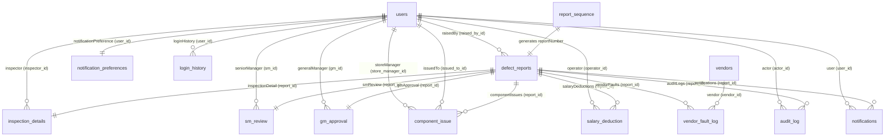
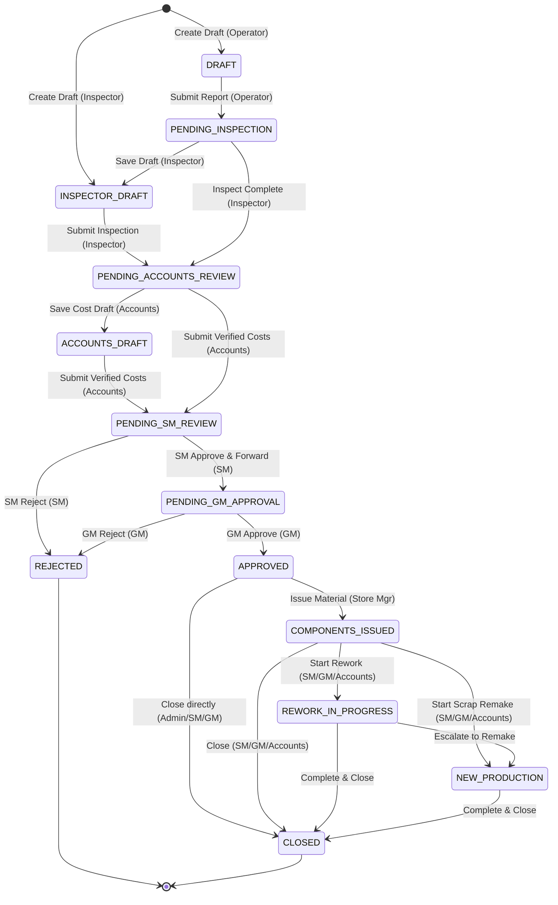

# Technical Audit & Integration Specification: ECR Digitization System

**Document Version:** 1.0.0  
**Audit Target:** Velan Quality Hub — Enterprise Quality Report (ECR) Digitization System  
**Audit Date:** 2026-10-31  
**Scope:** Architecture, Data Model, State Machines, APIs, Notifications, Master Data, Integration Readiness, and RM App Sibling Interoperability  

---

## 1. Stack and Runtime

### 1.1 Languages, Runtimes, and Engines
* **Backend Language:** TypeScript `^5.5.3` ([ecr-system/package.json#L62](file:///c:/Users/Admin/Downloads/ERROR%20CORRECTION%20APPLICATION/ecr-system/package.json#L62)) executed under Node.js runtime `22.x` ([package.json#L7](file:///c:/Users/Admin/Downloads/ERROR%20CORRECTION%20APPLICATION/package.json#L7), [.nvmrc#L1](file:///c:/Users/Admin/Downloads/ERROR%20CORRECTION%20APPLICATION/.nvmrc#L1), [render.yaml#L8](file:///c:/Users/Admin/Downloads/ERROR%20CORRECTION%20APPLICATION/render.yaml#L8)).
* **Frontend Language:** JavaScript (ES Module, JSX) with React `^18.2.0` ([frontend/package.json#L5, L18](file:///c:/Users/Admin/Downloads/ERROR%20CORRECTION%20APPLICATION/frontend/package.json#L5)).
* **Monorepo Architecture:** npm Workspaces coordinating root, `frontend`, and `ecr-system` ([package.json#L9-L12](file:///c:/Users/Admin/Downloads/ERROR%20CORRECTION%20APPLICATION/package.json#L9-L12)).

### 1.2 Frameworks and Core Libraries
* **Backend Framework:** NestJS `^10.4.0` (`@nestjs/core`, `@nestjs/common`, `@nestjs/platform-express`) ([ecr-system/package.json#L15-L21](file:///c:/Users/Admin/Downloads/ERROR%20CORRECTION%20APPLICATION/ecr-system/package.json#L15-L21)).
* **Frontend Framework & Tooling:** Vite `^5.0.0` build tool ([frontend/package.json#L33](file:///c:/Users/Admin/Downloads/ERROR%20CORRECTION%20APPLICATION/frontend/package.json#L33)), React Router DOM `^6.24.1` ([frontend/package.json#L22](file:///c:/Users/Admin/Downloads/ERROR%20CORRECTION%20APPLICATION/frontend/package.json#L22)), TanStack React Query `^5.101.2` ([frontend/package.json#L13](file:///c:/Users/Admin/Downloads/ERROR%20CORRECTION%20APPLICATION/frontend/package.json#L13)), Axios `^1.7.2` ([frontend/package.json#L14](file:///c:/Users/Admin/Downloads/ERROR%20CORRECTION%20APPLICATION/frontend/package.json#L14)), Socket.io Client `^4.8.3` ([frontend/package.json#L24](file:///c:/Users/Admin/Downloads/ERROR%20CORRECTION%20APPLICATION/frontend/package.json#L24)), Recharts `^3.9.1` ([frontend/package.json#L23](file:///c:/Users/Admin/Downloads/ERROR%20CORRECTION%20APPLICATION/frontend/package.json#L23)), JSPDF `^4.2.1` ([frontend/package.json#L16](file:///c:/Users/Admin/Downloads/ERROR%20CORRECTION%20APPLICATION/frontend/package.json#L16)), and XLSX `^0.18.5` ([frontend/package.json#L25](file:///c:/Users/Admin/Downloads/ERROR%20CORRECTION%20APPLICATION/frontend/package.json#L25)).
* **Security & Middleware:** Helmet `^8.3.0` Content-Security-Policy ([ecr-system/src/main.ts#L24-L37](file:///c:/Users/Admin/Downloads/ERROR%20CORRECTION%20APPLICATION/ecr-system/src/main.ts#L24-L37)), Compression `^1.8.1` ([ecr-system/src/main.ts#L40](file:///c:/Users/Admin/Downloads/ERROR%20CORRECTION%20APPLICATION/ecr-system/src/main.ts#L40)), Cookie-Parser `^1.4.7` ([ecr-system/src/main.ts#L21](file:///c:/Users/Admin/Downloads/ERROR%20CORRECTION%20APPLICATION/ecr-system/src/main.ts#L21)), ThrottlerModule rate limiting (default 60 req/min, auth 10 req/min) ([ecr-system/src/app.module.ts#L64-L75](file:///c:/Users/Admin/Downloads/ERROR%20CORRECTION%20APPLICATION/ecr-system/src/app.module.ts#L64-L75)).

### 1.3 Database Engine and ORM / Migrations
* **Database Engine:** PostgreSQL via Neon Serverless Postgres or local PostgreSQL instance accessed through connection string `DATABASE_URL` with SSL mode `ssl: { rejectUnauthorized: false }` ([ecr-system/src/app.module.ts#L87-L89](file:///c:/Users/Admin/Downloads/ERROR%20CORRECTION%20APPLICATION/ecr-system/src/app.module.ts#L87-L89)). Driver: `pg` `^8.12.0` ([ecr-system/package.json#L40](file:///c:/Users/Admin/Downloads/ERROR%20CORRECTION%20APPLICATION/ecr-system/package.json#L40)).
* **ORM:** TypeORM `^0.3.31` integrated via `@nestjs/typeorm` `^10.0.2` ([ecr-system/package.json#L26, L44](file:///c:/Users/Admin/Downloads/ERROR%20CORRECTION%20APPLICATION/ecr-system/package.json#L26)).
* **Data Source CLI Configuration:** `ecr-system/src/config/data-source.ts#L6-L13` ([ecr-system/src/config/data-source.ts#L6-L13](file:///c:/Users/Admin/Downloads/ERROR%20CORRECTION%20APPLICATION/ecr-system/src/config/data-source.ts#L6-L13)).
* **Migration Strategy:** TypeORM migrations executed automatically on application startup (`migrationsRun: true` in [ecr-system/src/app.module.ts#L92](file:///c:/Users/Admin/Downloads/ERROR%20CORRECTION%20APPLICATION/ecr-system/src/app.module.ts#L92)). Historical migration scripts:
  * `1783487119085-PostgresMigration.ts` ([ecr-system/src/migrations/1783487119085-PostgresMigration.ts](file:///c:/Users/Admin/Downloads/ERROR%20CORRECTION%20APPLICATION/ecr-system/src/migrations/1783487119085-PostgresMigration.ts))
  * `1783488677821-HistoryAndIndexes.ts` ([ecr-system/src/migrations/1783488677821-HistoryAndIndexes.ts](file:///c:/Users/Admin/Downloads/ERROR%20CORRECTION%20APPLICATION/ecr-system/src/migrations/1783488677821-HistoryAndIndexes.ts))
  * `1783500000000-AddDcNumber.ts` ([ecr-system/src/migrations/1783500000000-AddDcNumber.ts](file:///c:/Users/Admin/Downloads/ERROR%20CORRECTION%20APPLICATION/ecr-system/src/migrations/1783500000000-AddDcNumber.ts))
  * `1783510000000-AddAccountsDraftStatus.ts` ([ecr-system/src/migrations/1783510000000-AddAccountsDraftStatus.ts](file:///c:/Users/Admin/Downloads/ERROR%20CORRECTION%20APPLICATION/ecr-system/src/migrations/1783510000000-AddAccountsDraftStatus.ts))
  * `1783520000000-AddInspectorDraftStatus.ts` ([ecr-system/src/migrations/1783520000000-AddInspectorDraftStatus.ts](file:///c:/Users/Admin/Downloads/ERROR%20CORRECTION%20APPLICATION/ecr-system/src/migrations/1783520000000-AddInspectorDraftStatus.ts))
  * `1783530000000-AddCustomerAndMaterialToResponsiblePartyEnum.ts` ([ecr-system/src/migrations/1783530000000-AddCustomerAndMaterialToResponsiblePartyEnum.ts](file:///c:/Users/Admin/Downloads/ERROR%20CORRECTION%20APPLICATION/ecr-system/src/migrations/1783530000000-AddCustomerAndMaterialToResponsiblePartyEnum.ts))
* **Runtime Synchronization:** In development mode (`NODE_ENV !== 'production'`), TypeORM `synchronize: true` executes dynamic schema sync; additionally, `DefectReportsService.onModuleInit()` runs raw SQL alter statements on startup to guarantee enum definitions match runtime expectations ([ecr-system/src/defect-reports/defect-reports.service.ts#L58-L66](file:///c:/Users/Admin/Downloads/ERROR%20CORRECTION%20APPLICATION/ecr-system/src/defect-reports/defect-reports.service.ts#L58-L66)).

### 1.4 Authentication and Authorization Method
* **User Authentication:** Stateless JSON Web Tokens (`@nestjs/jwt` `^10.2.0`, `passport-jwt` `^4.0.1`, `bcrypt` `^5.1.1`) ([ecr-system/package.json#L19, L29, L39](file:///c:/Users/Admin/Downloads/ERROR%20CORRECTION%20APPLICATION/ecr-system/package.json#L19)).
* **Token Transport:** JWT token issued on login is placed into an `HttpOnly` cookie named `token` (`sameSite: 'lax'`, `maxAge: 8 * 60 * 60 * 1000` = 8 hours) while also being returned in the JSON response payload as `accessToken` ([ecr-system/src/auth/auth.service.ts#L58-L78](file:///c:/Users/Admin/Downloads/ERROR%20CORRECTION%20APPLICATION/ecr-system/src/auth/auth.service.ts#L58-L78)).
* **Token Extraction:** `JwtStrategy` extracts JWT first from `req.cookies.token`, falling back to the standard `Authorization: Bearer <token>` header ([ecr-system/src/auth/strategies/jwt.strategy.ts#L24-L27](file:///c:/Users/Admin/Downloads/ERROR%20CORRECTION%20APPLICATION/ecr-system/src/auth/strategies/jwt.strategy.ts#L24-L27)).
* **Internal API Machine-to-Machine Auth:** Pre-shared secret token passed in HTTP header `x-internal-secret` and compared directly to environment variable `ECR_INTERNAL_SECRET` ([ecr-system/src/internal/guards/internal-secret.guard.ts#L7-L11](file:///c:/Users/Admin/Downloads/ERROR%20CORRECTION%20APPLICATION/ecr-system/src/internal/guards/internal-secret.guard.ts#L7-L11)).

### 1.5 Hosting and Deployment Architecture
* **Target Platform:** Render Cloud Platform specified via `render.yaml` ([render.yaml#L1-L18](file:///c:/Users/Admin/Downloads/ERROR%20CORRECTION%20APPLICATION/render.yaml#L1-L18)).
* **Build Pipeline:** `npm run render-build` triggers `npm install --include=dev && npm run build` which invokes Vite to compile the frontend and Nest CLI to build the backend ([package.json#L14-L16](file:///c:/Users/Admin/Downloads/ERROR%20CORRECTION%20APPLICATION/package.json#L14-L16)).
* **Runtime Process:** Single container process executing `node dist/main` from `ecr-system` workspace ([package.json#L15](file:///c:/Users/Admin/Downloads/ERROR%20CORRECTION%20APPLICATION/package.json#L15)).
* **Frontend Delivery:** Single Origin Monolith. Compiled SPA static assets in `ecr-system/public` are served directly by NestJS via `@nestjs/serve-static` (`ServeStaticModule.forRoot`), excluding routes under `/api/(.*)` ([ecr-system/src/app.module.ts#L78-L81](file:///c:/Users/Admin/Downloads/ERROR%20CORRECTION%20APPLICATION/ecr-system/src/app.module.ts#L78-L81)).

### 1.6 Environment and Configuration Files
* **Configuration Loader:** `@nestjs/config` `ConfigModule.forRoot` ([ecr-system/src/app.module.ts#L33-L63](file:///c:/Users/Admin/Downloads/ERROR%20CORRECTION%20APPLICATION/ecr-system/src/app.module.ts#L33-L63)).
* **File Cascade:** In production: `.env.production`, `.env`. In development: `.env.development`, `.env.local`, `.env` ([ecr-system/src/app.module.ts#L35-L37](file:///c:/Users/Admin/Downloads/ERROR%20CORRECTION%20APPLICATION/ecr-system/src/app.module.ts#L35-L37)). Template committed at `.env.example` ([.env.example#L1-L40](file:///c:/Users/Admin/Downloads/ERROR%20CORRECTION%20APPLICATION/.env.example#L1-L40)).
* **Mandatory Boot Variables:** `DATABASE_URL`, `JWT_SECRET`, `EMAIL_FROM`, plus (`GMAIL_SCRIPT_URL` + `GMAIL_SCRIPT_TOKEN`) OR `GMAIL_APP_PASSWORD` ([ecr-system/src/app.module.ts#L42-L60](file:///c:/Users/Admin/Downloads/ERROR%20CORRECTION%20APPLICATION/ecr-system/src/app.module.ts#L42-L60)).
* **Key Optional Variables:** `PORT` (default 3000), `FRONTEND_URL` (used for email deep-links), `ECR_INTERNAL_SECRET` (default `vsmart_ecr_bridge_2026_secure` in `.env.example#L34`), `VITE_API_BASE` (frontend Vite proxy target).

### 1.7 Background Job / Queue / Cron System
* **Cron Framework:** `@nestjs/schedule` `ScheduleModule.forRoot()` ([ecr-system/src/app.module.ts#L77](file:///c:/Users/Admin/Downloads/ERROR%20CORRECTION%20APPLICATION/ecr-system/src/app.module.ts#L77)).
* **Registered Background Tasks:**
  1. `EmailQueueService.processEmailQueue`: `@Cron(CronExpression.EVERY_MINUTE)` polling up to 100 `EmailLog` records with status `PENDING` or `FAILED` ([ecr-system/src/email/services/email-queue.service.ts#L48-L80](file:///c:/Users/Admin/Downloads/ERROR%20CORRECTION%20APPLICATION/ecr-system/src/email/services/email-queue.service.ts#L48-L80)). Also triggered asynchronously via internal event `email.logs.updated`.
  2. `NotificationRetryCron.handleRetry`: `@Cron('0 * * * * *')` (every minute) retrying `Notification` records with status `FAILED` up to 3 attempts ([ecr-system/src/notifications/notification-retry.cron.ts#L35-L50](file:///c:/Users/Admin/Downloads/ERROR%20CORRECTION%20APPLICATION/ecr-system/src/notifications/notification-retry.cron.ts#L35-L50)).
* **Decoupled Event Bus:** NestJS `EventEmitterModule.forRoot()` (`EventEmitter2`) ([ecr-system/src/app.module.ts#L76](file:///c:/Users/Admin/Downloads/ERROR%20CORRECTION%20APPLICATION/ecr-system/src/app.module.ts#L76)). Dispatches events `report.status.changed`, `component.issued`, `salary.deduction.created`, `vendor.fault.created`, `report.approved.operator_fault`, `report.approved.vendor_fault`.
* **External Queue Broker:** NONE. No Redis, BullMQ, Kafka, or RabbitMQ instance is used. All retries and queues reside in PostgreSQL tables (`email_logs` and `notifications`).

---

## 2. Data Model

### 2.1 Table Inventory and Schemas

#### A. Core Workflow Tables

##### 1. `defect_reports`
* **Entity:** `DefectReport` ([ecr-system/src/defect-reports/defect-report.entity.ts#L22-L140](file:///c:/Users/Admin/Downloads/ERROR%20CORRECTION%20APPLICATION/ecr-system/src/defect-reports/defect-report.entity.ts#L22-L140))
* **Primary Key:** `id` (`uuid`, generated)
* **Unique Constraints:** `reportNumber` (`varchar`, nullable in table definition, generated upon creation as `AGIPL-YYYY-ERR-XXXXX` [ecr-system/src/defect-reports/defect-report.entity.ts#L28-L29](file:///c:/Users/Admin/Downloads/ERROR%20CORRECTION%20APPLICATION/ecr-system/src/defect-reports/defect-report.entity.ts#L28-L29))
* **Foreign Keys:**
  * `raised_by_id` -> `users(id)` (`ON DELETE SET NULL`, nullable) ([ecr-system/src/defect-reports/defect-report.entity.ts#L31-L37](file:///c:/Users/Admin/Downloads/ERROR%20CORRECTION%20APPLICATION/ecr-system/src/defect-reports/defect-report.entity.ts#L31-L37))
* **Columns:**
  * `id`: `uuid` (PK)
  * `reportNumber`: `varchar`, unique, nullable
  * `raised_by_id` / `raisedById`: `uuid`, FK to `users`
  * `raisedByRole`: `enum` (`OPERATOR`, `INSPECTOR`, `SENIOR_MANAGER`) ([ecr-system/src/common/enums/report-status.enum.ts#L17-L21](file:///c:/Users/Admin/Downloads/ERROR%20CORRECTION%20APPLICATION/ecr-system/src/common/enums/report-status.enum.ts#L17-L21))
  * `scOrPoNo`: `varchar`, not null
  * `scNo`: `varchar`, nullable
  * `poNo`: `varchar`, nullable
  * `productId`: `varchar`, nullable
  * `componentName`: `varchar`, nullable (stores raw string name of component)
  * `errorTypeName`: `varchar`, nullable (stores raw string name of error type)
  * `partNumber`: `varchar`, nullable
  * `batchNumber`: `varchar`, nullable
  * `quantity`: `int`, default 1
  * `stageOfFailure`: `varchar`, not null
  * `defectDescription`: `text`, not null
  * `reworkDescription`: `text`, nullable
  * `images`: `simple-json` / `text`, default `'[]'` (stores string array of Cloudinary/disk URLs)
  * `status`: `enum` (`DRAFT`, `PENDING_INSPECTION`, `INSPECTOR_DRAFT`, `PENDING_ACCOUNTS_REVIEW`, `ACCOUNTS_DRAFT`, `PENDING_SM_REVIEW`, `PENDING_GM_APPROVAL`, `APPROVED`, `REJECTED`, `COMPONENTS_ISSUED`, `REWORK_IN_PROGRESS`, `NEW_PRODUCTION`, `CLOSED`) ([ecr-system/src/common/enums/report-status.enum.ts#L1-L15](file:///c:/Users/Admin/Downloads/ERROR%20CORRECTION%20APPLICATION/ecr-system/src/common/enums/report-status.enum.ts#L1-L15)), default `DRAFT`
  * `inspectionType`: `varchar`, nullable (`'REWORK'` | `'REJECTION'`)
  * `componentsIssued`: `boolean`, default `false`
  * `componentsIssuedById`: `varchar`, nullable
  * `componentsIssuedAt`: `timestamp`, nullable
  * `issueRemarks`: `text`, nullable
  * `accountsDescription` (DB column `sales_description`): `text`, nullable
  * `rejectionProcessTemplate` (DB column `rejection_process_template`): `varchar`, nullable
  * `rejectionFailedStage` (DB column `rejection_failed_stage`): `varchar`, nullable
  * `rejectionStageCosts` (DB column `rejection_stage_costs`): `json`, nullable
  * `rejectionDescription` (DB column `rejection_description`): `text`, nullable
  * `createdAt`: `timestamp`, auto-generated
  * `updatedAt`: `timestamp`, auto-updated
* **Indexes:** Compound index `(status, createdAt)` ([ecr-system/src/defect-reports/defect-report.entity.ts#L21](file:///c:/Users/Admin/Downloads/ERROR%20CORRECTION%20APPLICATION/ecr-system/src/defect-reports/defect-report.entity.ts#L21)), Compound index `(status, componentsIssued)` ([ecr-system/src/defect-reports/defect-report.entity.ts#L83](file:///c:/Users/Admin/Downloads/ERROR%20CORRECTION%20APPLICATION/ecr-system/src/defect-reports/defect-report.entity.ts#L83)), index on `raised_by_id`, `scOrPoNo`, `status`, `createdAt`, `updatedAt`.
* **Soft Delete:** NONE. Deleted physically by Admin via `DefectReportsService.hardDelete()` ([ecr-system/src/defect-reports/defect-reports.service.ts#L194-L312](file:///c:/Users/Admin/Downloads/ERROR%20CORRECTION%20APPLICATION/ecr-system/src/defect-reports/defect-reports.service.ts#L194-L312)).

##### 2. `inspection_details`
* **Entity:** `InspectionDetail` ([ecr-system/src/inspection/inspection-detail.entity.ts#L15-L98](file:///c:/Users/Admin/Downloads/ERROR%20CORRECTION%20APPLICATION/ecr-system/src/inspection/inspection-detail.entity.ts#L15-L98))
* **Primary Key:** `id` (`uuid`, generated)
* **Foreign Keys:**
  * `report_id` -> `defect_reports(id)` (`OneToOne`, unique constraint `REL_76631cab38e360c3fc78518be0`) ([ecr-system/src/inspection/inspection-detail.entity.ts#L21-L26](file:///c:/Users/Admin/Downloads/ERROR%20CORRECTION%20APPLICATION/ecr-system/src/inspection/inspection-detail.entity.ts#L21-L26))
  * `inspector_id` -> `users(id)` (`ON DELETE SET NULL`, nullable) ([ecr-system/src/inspection/inspection-detail.entity.ts#L28-L34](file:///c:/Users/Admin/Downloads/ERROR%20CORRECTION%20APPLICATION/ecr-system/src/inspection/inspection-detail.entity.ts#L28-L34))
* **Columns:**
  * `id`: `uuid` (PK)
  * `report_id` / `reportId`: `uuid`, FK (unique)
  * `inspector_id` / `inspectorId`: `uuid`, FK, nullable
  * `errorType`: `varchar`, nullable
  * `rootCause`: `text`, nullable
  * `responsibleParty`: `enum` (`OPERATOR`, `VENDOR`, `PROCESS`, `MACHINE`, `CUSTOMER`, `MATERIAL`) ([ecr-system/src/common/enums/report-status.enum.ts#L29-L36](file:///c:/Users/Admin/Downloads/ERROR%20CORRECTION%20APPLICATION/ecr-system/src/common/enums/report-status.enum.ts#L29-L36))
  * `responsibleId`: `varchar`, nullable (stores Operator User UUID, Vendor UUID, or Customer string)
  * `decision`: `enum` (`REWORK`, `SCRAP`, `ALTERNATIVE`) ([ecr-system/src/common/enums/report-status.enum.ts#L23-L27](file:///c:/Users/Admin/Downloads/ERROR%20CORRECTION%20APPLICATION/ecr-system/src/common/enums/report-status.enum.ts#L23-L27)), nullable
  * `alternativeNote`: `text`, nullable
  * `costEstimate`: `decimal(12,2)`, default 0
  * `materialCost`: `decimal(12,2)`, default 0, nullable
  * `labourCost`: `decimal(12,2)`, default 0, nullable
  * `otherCost`: `decimal(12,2)`, default 0, nullable
  * `costRemarks`: `text`, nullable
  * `timeEstimateHours`: `decimal(8,2)`, default 0, nullable
  * `lossAmount`: `decimal(12,2)`, nullable
  * `reworkDescription`: `text`, nullable
  * `rejectionProcessTemplate` (DB column `rejection_process_template`): `varchar`, nullable
  * `rejectionFailedStage` (DB column `rejection_failed_stage`): `varchar`, nullable
  * `rejectionStageCosts` (DB column `rejection_stage_costs`): `json`, nullable
  * `rejectionDescription` (DB column `rejection_description`): `text`, nullable
  * `dcNumber` (DB column `dc_number`): `varchar`, nullable
  * `reviewedAt`: `timestamp`, default `now()`
* **Indexes:** Compound index `(responsibleParty, responsibleId)` ([ecr-system/src/inspection/inspection-detail.entity.ts#L16](file:///c:/Users/Admin/Downloads/ERROR%20CORRECTION%20APPLICATION/ecr-system/src/inspection/inspection-detail.entity.ts#L16)), index on `inspector_id`.

##### 3. `sm_review`
* **Entity:** `SmReview` ([ecr-system/src/sm-review/sm-review.entity.ts#L14-L49](file:///c:/Users/Admin/Downloads/ERROR%20CORRECTION%20APPLICATION/ecr-system/src/sm-review/sm-review.entity.ts#L14-L49))
* **Primary Key:** `id` (`uuid`, generated)
* **Foreign Keys:**
  * `report_id` -> `defect_reports(id)` (`OneToOne`, unique constraint `REL_a2ca31ec6e7928c90e1154f49e`) ([ecr-system/src/sm-review/sm-review.entity.ts#L19-L24](file:///c:/Users/Admin/Downloads/ERROR%20CORRECTION%20APPLICATION/ecr-system/src/sm-review/sm-review.entity.ts#L19-L24))
  * `sm_id` -> `users(id)` (`ON DELETE SET NULL`, nullable) ([ecr-system/src/sm-review/sm-review.entity.ts#L26-L32](file:///c:/Users/Admin/Downloads/ERROR%20CORRECTION%20APPLICATION/ecr-system/src/sm-review/sm-review.entity.ts#L26-L32))
* **Columns:**
  * `id`: `uuid` (PK)
  * `report_id` / `reportId`: `uuid`, FK (unique)
  * `sm_id` / `smId`: `uuid`, FK, nullable
  * `loopholeNote`: `text`, not null
  * `decisionNote`: `text`, not null
  * `biasedFlag`: `boolean`, default `false`
  * `forwardedToGm`: `boolean`, default `false`
  * `reviewedAt`: `timestamp`, default `now()`

##### 4. `gm_approval`
* **Entity:** `GmApproval` ([ecr-system/src/gm-approval/gm-approval.entity.ts#L15-L51](file:///c:/Users/Admin/Downloads/ERROR%20CORRECTION%20APPLICATION/ecr-system/src/gm-approval/gm-approval.entity.ts#L15-L51))
* **Primary Key:** `id` (`uuid`, generated)
* **Foreign Keys:**
  * `report_id` -> `defect_reports(id)` (`OneToOne`, unique constraint `REL_1ee3dc9a6a2a4b827efbce8234`) ([ecr-system/src/gm-approval/gm-approval.entity.ts#L20-L25](file:///c:/Users/Admin/Downloads/ERROR%20CORRECTION%20APPLICATION/ecr-system/src/gm-approval/gm-approval.entity.ts#L20-L25))
  * `gm_id` -> `users(id)` (`ON DELETE SET NULL`, nullable) ([ecr-system/src/gm-approval/gm-approval.entity.ts#L27-L33](file:///c:/Users/Admin/Downloads/ERROR%20CORRECTION%20APPLICATION/ecr-system/src/gm-approval/gm-approval.entity.ts#L27-L33))
* **Columns:**
  * `id`: `uuid` (PK)
  * `report_id` / `reportId`: `uuid`, FK (unique)
  * `gm_id` / `gmId`: `uuid`, FK, nullable
  * `approved`: `boolean`, not null
  * `remarks`: `text`, nullable
  * `messageToSm`: `text`, nullable (excluded from general serialized responses via class-transformer `@Exclude`, exposed only to GM and SM roles [ecr-system/src/gm-approval/gm-approval.entity.ts#L41-L44](file:///c:/Users/Admin/Downloads/ERROR%20CORRECTION%20APPLICATION/ecr-system/src/gm-approval/gm-approval.entity.ts#L41-L44))
  * `budgetApproved`: `decimal(12,2)`, nullable
  * `approvedAt`: `timestamp`, default `now()`

##### 5. `component_issue`
* **Entity:** `ComponentIssue` ([ecr-system/src/component-issue/component-issue.entity.ts#L18-L52](file:///c:/Users/Admin/Downloads/ERROR%20CORRECTION%20APPLICATION/ecr-system/src/component-issue/component-issue.entity.ts#L18-L52))
* **Primary Key:** `id` (`uuid`, generated)
* **Foreign Keys:**
  * `report_id` -> `defect_reports(id)` ([ecr-system/src/component-issue/component-issue.entity.ts#L23-L28](file:///c:/Users/Admin/Downloads/ERROR%20CORRECTION%20APPLICATION/ecr-system/src/component-issue/component-issue.entity.ts#L23-L28))
  * `store_manager_id` -> `users(id)` (`ON DELETE SET NULL`, nullable) ([ecr-system/src/component-issue/component-issue.entity.ts#L30-L35](file:///c:/Users/Admin/Downloads/ERROR%20CORRECTION%20APPLICATION/ecr-system/src/component-issue/component-issue.entity.ts#L30-L35))
  * `issued_to_id` -> `users(id)` (`ON DELETE SET NULL`, nullable) ([ecr-system/src/component-issue/component-issue.entity.ts#L40-L45](file:///c:/Users/Admin/Downloads/ERROR%20CORRECTION%20APPLICATION/ecr-system/src/component-issue/component-issue.entity.ts#L40-L45))
* **Columns:**
  * `id`: `uuid` (PK)
  * `report_id` / `reportId`: `uuid`, FK
  * `store_manager_id` / `storeManagerId`: `uuid`, FK, nullable
  * `components`: `simple-json` / `text` (array of objects: `{ componentId: string, componentName: string, qty: number }` [ecr-system/src/component-issue/component-issue.entity.ts#L12-L16, L37-L38](file:///c:/Users/Admin/Downloads/ERROR%20CORRECTION%20APPLICATION/ecr-system/src/component-issue/component-issue.entity.ts#L12-L16))
  * `issued_to_id` / `issuedToId`: `uuid`, FK, nullable
  * `remarks`: `text`, nullable
  * `issuedAt`: `timestamp`, default `now()`

##### 6. `report_sequence`
* **Entity:** `ReportSequence` ([ecr-system/src/defect-reports/report-sequence.entity.ts#L3-L10](file:///c:/Users/Admin/Downloads/ERROR%20CORRECTION%20APPLICATION/ecr-system/src/defect-reports/report-sequence.entity.ts#L3-L10))
* **Primary Key:** `id` (`varchar`, key: `'AGIPL'`)
* **Columns:**
  * `id`: `varchar` (PK)
  * `lastValue`: `int`, default 0

#### B. Users and Authentication Tables

##### 7. `users`
* **Entity:** `User` ([ecr-system/src/users/user.entity.ts#L13-L50](file:///c:/Users/Admin/Downloads/ERROR%20CORRECTION%20APPLICATION/ecr-system/src/users/user.entity.ts#L13-L50))
* **Primary Key:** `id` (`uuid`, generated)
* **Unique Constraints:** `email` (`UQ_97672ac88f789774dd47f7c8be3`) ([ecr-system/src/users/user.entity.ts#L21](file:///c:/Users/Admin/Downloads/ERROR%20CORRECTION%20APPLICATION/ecr-system/src/users/user.entity.ts#L21))
* **Columns:**
  * `id`: `uuid` (PK)
  * `name`: `varchar`, not null
  * `email`: `varchar`, unique, not null
  * `passwordHash`: `varchar`, hidden by default (`select: false`)
  * `role`: `enum` (`OPERATOR`, `INSPECTOR`, `SENIOR_MANAGER`, `GENERAL_MANAGER`, `STORE_MANAGER`, `ACCOUNTS`, `ADMIN`) ([ecr-system/src/common/enums/role.enum.ts#L1-L9](file:///c:/Users/Admin/Downloads/ERROR%20CORRECTION%20APPLICATION/ecr-system/src/common/enums/role.enum.ts#L1-L9))
  * `department`: `varchar`, nullable
  * `salaryRefId`: `varchar`, nullable (employee payroll reference code)
  * `isActive`: `boolean`, default `true`
  * `createdAt`: `timestamp`, default `now()`
  * `updatedAt`: `timestamp`, default `now()`
* **Indexes:** Index on `role` ([ecr-system/src/users/user.entity.ts#L27](file:///c:/Users/Admin/Downloads/ERROR%20CORRECTION%20APPLICATION/ecr-system/src/users/user.entity.ts#L27)), Index on `salaryRefId` ([ecr-system/src/users/user.entity.ts#L35](file:///c:/Users/Admin/Downloads/ERROR%20CORRECTION%20APPLICATION/ecr-system/src/users/user.entity.ts#L35)).

##### 8. `login_history`
* **Entity:** `LoginHistory` ([ecr-system/src/users/login-history.entity.ts#L12-L34](file:///c:/Users/Admin/Downloads/ERROR%20CORRECTION%20APPLICATION/ecr-system/src/users/login-history.entity.ts#L12-L34))
* **Primary Key:** `id` (`uuid`, generated)
* **Foreign Keys:** `user_id` -> `users(id)` (`ON DELETE CASCADE`)
* **Columns:**
  * `id`: `uuid` (PK)
  * `user_id` / `userId`: `uuid`, FK
  * `ipAddress`: `varchar`, nullable
  * `userAgent`: `varchar`, nullable
  * `timestamp`: `timestamp`, default `now()`
* **Indexes:** Index on `user_id`, Index on `timestamp`.

#### C. Accountability and Fault Tracking Tables

##### 9. `salary_deduction`
* **Entity:** `SalaryDeduction` ([ecr-system/src/salary-deduction/salary-deduction.entity.ts#L13-L50](file:///c:/Users/Admin/Downloads/ERROR%20CORRECTION%20APPLICATION/ecr-system/src/salary-deduction/salary-deduction.entity.ts#L13-L50))
* **Primary Key:** `id` (`uuid`, generated)
* **Foreign Keys:**
  * `report_id` -> `defect_reports(id)` ([ecr-system/src/salary-deduction/salary-deduction.entity.ts#L18-L24](file:///c:/Users/Admin/Downloads/ERROR%20CORRECTION%20APPLICATION/ecr-system/src/salary-deduction/salary-deduction.entity.ts#L18-L24))
  * `operator_id` -> `users(id)` (`ON DELETE SET NULL`, nullable) ([ecr-system/src/salary-deduction/salary-deduction.entity.ts#L26-L32](file:///c:/Users/Admin/Downloads/ERROR%20CORRECTION%20APPLICATION/ecr-system/src/salary-deduction/salary-deduction.entity.ts#L26-L32))
* **Columns:**
  * `id`: `uuid` (PK)
  * `report_id` / `reportId`: `uuid`, FK
  * `operator_id` / `operatorId`: `uuid`, FK, nullable
  * `amount`: `decimal(10,2)`, not null
  * `status`: `varchar`, default `'PENDING'` (`PENDING`, `APPROVED`, `CANCELLED`, `PAID`) ([ecr-system/src/salary-deduction/salary-deduction.entity.ts#L38-L39](file:///c:/Users/Admin/Downloads/ERROR%20CORRECTION%20APPLICATION/ecr-system/src/salary-deduction/salary-deduction.entity.ts#L38-L39))
  * `reason`: `text`, nullable
  * `monthRef`: `varchar`, not null (e.g. `'2026-07'`)
  * `createdAt`: `timestamp`, default `now()`
* **Indexes:** Index on `report_id`, Index on `operator_id`, Index on `status`.

##### 10. `vendor_fault_log`
* **Entity:** `VendorFaultLog` ([ecr-system/src/vendor-fault/vendor-fault-log.entity.ts#L14-L54](file:///c:/Users/Admin/Downloads/ERROR%20CORRECTION%20APPLICATION/ecr-system/src/vendor-fault/vendor-fault-log.entity.ts#L14-L54))
* **Primary Key:** `id` (`uuid`, generated)
* **Foreign Keys:**
  * `report_id` -> `defect_reports(id)` ([ecr-system/src/vendor-fault/vendor-fault-log.entity.ts#L19-L25](file:///c:/Users/Admin/Downloads/ERROR%20CORRECTION%20APPLICATION/ecr-system/src/vendor-fault/vendor-fault-log.entity.ts#L19-L25))
  * `vendor_id` -> `vendors(id)` ([ecr-system/src/vendor-fault/vendor-fault-log.entity.ts#L27-L33](file:///c:/Users/Admin/Downloads/ERROR%20CORRECTION%20APPLICATION/ecr-system/src/vendor-fault/vendor-fault-log.entity.ts#L27-L33))
* **Columns:**
  * `id`: `uuid` (PK)
  * `report_id` / `reportId`: `uuid`, FK
  * `vendor_id` / `vendorId`: `uuid`, FK
  * `note`: `text`, not null
  * `recoveryAmount`: `decimal(12,2)`, default 0
  * `recoveryStatus`: `enum` (`PENDING`, `RAISED`, `RECOVERED`, `PARTIALLY_RECOVERED`, `WAIVED`, `CANCELLED`) ([ecr-system/src/common/enums/report-status.enum.ts#L38-L45](file:///c:/Users/Admin/Downloads/ERROR%20CORRECTION%20APPLICATION/ecr-system/src/common/enums/report-status.enum.ts#L38-L45)), default `PENDING`
  * `raisedAt`: `timestamp`, default `now()`
  * `recoveredAt`: `timestamp`, nullable
* **Indexes:** Index on `report_id`, Index on `vendor_id`, Index on `recoveryStatus`.

#### D. Auditing and Logging Tables

##### 11. `audit_log`
* **Entity:** `AuditLog` ([ecr-system/src/audit-log/audit-log.entity.ts#L24-L71](file:///c:/Users/Admin/Downloads/ERROR%20CORRECTION%20APPLICATION/ecr-system/src/audit-log/audit-log.entity.ts#L24-L71))
* **Primary Key:** `id` (`uuid`, generated)
* **Foreign Keys:**
  * `report_id` -> `defect_reports(id)` ([ecr-system/src/audit-log/audit-log.entity.ts#L29-L35](file:///c:/Users/Admin/Downloads/ERROR%20CORRECTION%20APPLICATION/ecr-system/src/audit-log/audit-log.entity.ts#L29-L35))
  * `actor_id` -> `users(id)` (`ON DELETE SET NULL`, nullable) ([ecr-system/src/audit-log/audit-log.entity.ts#L37-L43](file:///c:/Users/Admin/Downloads/ERROR%20CORRECTION%20APPLICATION/ecr-system/src/audit-log/audit-log.entity.ts#L37-L43))
* **Columns:**
  * `id`: `uuid` (PK)
  * `report_id` / `reportId`: `uuid`, FK
  * `actor_id` / `actorId`: `uuid`, FK, nullable
  * `actorRole`: `varchar`, not null
  * `actionType`: `enum` (`STATUS_CHANGE`, `FIELD_EDIT`, `INVENTORY_UPDATED`, `COMPONENT_ISSUED`, `SALARY_DEDUCTION_CREATED`, `VENDOR_FAULT_CREATED`, `IMAGE_UPLOADED`) ([ecr-system/src/audit-log/audit-log.entity.ts#L13-L21](file:///c:/Users/Admin/Downloads/ERROR%20CORRECTION%20APPLICATION/ecr-system/src/audit-log/audit-log.entity.ts#L13-L21))
  * `fieldName`: `varchar`, nullable
  * `oldValue`: `text`, nullable
  * `newValue`: `text`, nullable
  * `fromStatus`: `varchar`, nullable
  * `toStatus`: `varchar`, nullable
  * `note`: `text`, nullable
  * `timestamp`: `timestamp`, default `now()`
* **Indexes:** Index on `report_id`, Index on `actor_id`, Index on `timestamp`.

##### 12. `email_logs`
* **Entity:** `EmailLog` ([ecr-system/src/email/entities/email-log.entity.ts#L15-L74](file:///c:/Users/Admin/Downloads/ERROR%20CORRECTION%20APPLICATION/ecr-system/src/email/entities/email-log.entity.ts#L15-L74))
* **Primary Key:** `id` (`uuid`, generated)
* **Columns:**
  * `id`: `uuid` (PK)
  * `recipient`: `varchar`, not null
  * `cc`: `varchar`, nullable
  * `bcc`: `varchar`, nullable
  * `subject`: `varchar`, not null
  * `content`: `text`, not null
  * `isHtml`: `boolean`, default `true`
  * `event`: `enum` (`ReportCreated`, `ReportApproved`, `ReportRejected`, `ReportUpdated`, `Reminder`, `Escalation`, `ComponentIssued`, `VendorFault`, `SalaryDeduction`, `DailySummary`, `WeeklySummary`) ([ecr-system/src/email/enums/notification-event.enum.ts#L1-L13](file:///c:/Users/Admin/Downloads/ERROR%20CORRECTION%20APPLICATION/ecr-system/src/email/enums/notification-event.enum.ts#L1-L13))
  * `status`: `enum` (`PENDING`, `SENT`, `FAILED`, `CANCELLED`) ([ecr-system/src/email/enums/email-status.enum.ts#L1-L6](file:///c:/Users/Admin/Downloads/ERROR%20CORRECTION%20APPLICATION/ecr-system/src/email/enums/email-status.enum.ts#L1-L6)), default `PENDING`
  * `sentTime`: `timestamp`, nullable
  * `retryCount`: `int`, default 0
  * `failureReason`: `text`, nullable
  * `relatedReportId`: `varchar`, nullable
  * `notificationId`: `varchar`, nullable
  * `providerMessageId`: `varchar`, nullable
  * `createdAt`: `timestamp`, default `now()`
  * `updatedAt`: `timestamp`, default `now()`
* **Indexes:** Compound index `(recipient, createdAt)`, `(status, createdAt)`, index on `event`.

##### 13. `email_monitoring_audit_logs`
* **Entity:** `EmailMonitoringAuditLog` ([ecr-system/src/email-monitoring/entities/email-monitoring-audit-log.entity.ts#L8-L30](file:///c:/Users/Admin/Downloads/ERROR%20CORRECTION%20APPLICATION/ecr-system/src/email-monitoring/entities/email-monitoring-audit-log.entity.ts#L8-L30))
* **Primary Key:** `id` (`uuid`, generated)
* **Columns:** `id` (`uuid`), `emailLogId` (`varchar`), `adminUserId` (`varchar`), `adminUsername` (`varchar`), `action` (`varchar`), `reason` (`varchar`, nullable), `timestamp` (`timestamp`, default `now()`).

#### E. Notification Tables

##### 14. `notifications`
* **Entity:** `Notification` ([ecr-system/src/notifications/notification.entity.ts#L19-L71](file:///c:/Users/Admin/Downloads/ERROR%20CORRECTION%20APPLICATION/ecr-system/src/notifications/notification.entity.ts#L19-L71))
* **Primary Key:** `id` (`uuid`, generated)
* **Foreign Keys:**
  * `user_id` -> `users(id)` (`ON DELETE CASCADE`) ([ecr-system/src/notifications/notification.entity.ts#L24-L30](file:///c:/Users/Admin/Downloads/ERROR%20CORRECTION%20APPLICATION/ecr-system/src/notifications/notification.entity.ts#L24-L30))
  * `report_id` -> `defect_reports(id)` (`nullable`) ([ecr-system/src/notifications/notification.entity.ts#L32-L38](file:///c:/Users/Admin/Downloads/ERROR%20CORRECTION%20APPLICATION/ecr-system/src/notifications/notification.entity.ts#L32-L38))
* **Columns:**
  * `id`: `uuid` (PK)
  * `user_id` / `userId`: `uuid`, FK
  * `report_id` / `reportId`: `uuid`, FK, nullable
  * `channel`: `enum` (`EMAIL`, `APP`, `APP_AND_EMAIL`) ([ecr-system/src/common/enums/report-status.enum.ts#L47-L51](file:///c:/Users/Admin/Downloads/ERROR%20CORRECTION%20APPLICATION/ecr-system/src/common/enums/report-status.enum.ts#L47-L51))
  * `type`: `varchar`, not null
  * `message`: `text`, not null
  * `read`: `boolean`, default `false`
  * `status`: `enum` (`QUEUED`, `SENT`, `FAILED`, `DELIVERED`) ([ecr-system/src/common/enums/report-status.enum.ts#L53-L58](file:///c:/Users/Admin/Downloads/ERROR%20CORRECTION%20APPLICATION/ecr-system/src/common/enums/report-status.enum.ts#L53-L58)), default `QUEUED`
  * `attemptCount`: `int`, default 0
  * `sentAt`: `timestamp`, nullable
  * `createdAt`: `timestamp`, default `now()`
  * `updatedAt`: `timestamp`, default `now()`
* **Indexes:** Compound index `(userId, createdAt)`, index on `userId`, `reportId`, `read`.

##### 15. `notification_preferences`
* **Entity:** `NotificationPreference` ([ecr-system/src/email/entities/notification-preference.entity.ts#L12-L44](file:///c:/Users/Admin/Downloads/ERROR%20CORRECTION%20APPLICATION/ecr-system/src/email/entities/notification-preference.entity.ts#L12-L44))
* **Primary Key:** `id` (`uuid`, generated)
* **Foreign Keys:** `user_id` -> `users(id)` (`OneToOne`, unique constraint `REL_64c90edc7310c6be7c10c96f67`)
* **Columns:** `id` (`uuid`), `user_id` / `userId` (`uuid`), `emailEnabled` (`bool`, default true), `inAppEnabled` (`bool`, default true), `dailySummary` (`bool`, default false), `weeklySummary` (`bool`, default false), `immediateNotifications` (`bool`, default true), `createdAt`, `updatedAt`.

#### F. Master Data Reference Tables

##### 16. `components`
* **Entity:** `Component` ([ecr-system/src/master-data/components/component.entity.ts#L3-L22](file:///c:/Users/Admin/Downloads/ERROR%20CORRECTION%20APPLICATION/ecr-system/src/master-data/components/component.entity.ts#L3-L22))
* **Primary Key:** `id` (`uuid`, generated)
* **Unique Constraints:** `code` (`UQ_5409124de81d8d24ef76b4a5315`)
* **Columns:** `id` (`uuid`), `code` (`varchar`, unique), `name` (`varchar`), `stockQty` (`int`, default 0), `unit` (`varchar`, nullable), `isActive` (`boolean`, default true).

##### 17. `cost_rates`
* **Entity:** `CostRate` ([ecr-system/src/master-data/cost-rates/cost-rate.entity.ts#L3-L16](file:///c:/Users/Admin/Downloads/ERROR%20CORRECTION%20APPLICATION/ecr-system/src/master-data/cost-rates/cost-rate.entity.ts#L3-L16))
* **Primary Key:** `id` (`uuid`, generated)
* **Columns:** `id` (`uuid`), `stageName` (`varchar`), `ratePerHour` (`decimal(10,2)`), `isActive` (`boolean`, default true).

##### 18. `error_types`
* **Entity:** `ErrorType` ([ecr-system/src/master-data/error-types/error-type.entity.ts#L3-L16](file:///c:/Users/Admin/Downloads/ERROR%20CORRECTION%20APPLICATION/ecr-system/src/master-data/error-types/error-type.entity.ts#L3-L16))
* **Primary Key:** `id` (`uuid`, generated)
* **Unique Constraints:** `name` (`UQ_e55020852b4fa050a3b907d8512`)
* **Columns:** `id` (`uuid`), `name` (`varchar`, unique), `description` (`text`, nullable), `isActive` (`boolean`, default true).

##### 19. `operators`
* **Entity:** `Operator` ([ecr-system/src/master-data/operators/operator.entity.ts#L3-L16](file:///c:/Users/Admin/Downloads/ERROR%20CORRECTION%20APPLICATION/ecr-system/src/master-data/operators/operator.entity.ts#L3-L16))
* **Primary Key:** `id` (`uuid`, generated)
* **Columns:** `id` (`uuid`), `name` (`varchar`), `operatorCode` (`varchar`, nullable), `isActive` (`boolean`, default true).

##### 20. `vendors`
* **Entity:** `Vendor` ([ecr-system/src/master-data/vendors/vendor.entity.ts#L3-L19](file:///c:/Users/Admin/Downloads/ERROR%20CORRECTION%20APPLICATION/ecr-system/src/master-data/vendors/vendor.entity.ts#L3-L19))
* **Primary Key:** `id` (`uuid`, generated)
* **Columns:** `id` (`uuid`), `name` (`varchar`), `contactEmail` (`varchar`, nullable), `contactPhone` (`varchar`, nullable), `isActive` (`boolean`, default true).

---

### 2.2 Entity Relationship Diagram (Mermaid)



---

### 2.3 Identification Formats Across Entities

| Entity / Concept | ID Type / Primary Key Format | Column Name & Location | Example Value | Integration Notes |
| :--- | :--- | :--- | :--- | :--- |
| **Defect Report (PK)** | UUID v4 | `defect_reports.id` ([defect-report.entity.ts#L25](file:///c:/Users/Admin/Downloads/ERROR%20CORRECTION%20APPLICATION/ecr-system/src/defect-reports/defect-report.entity.ts#L25)) | `4f3a8d9b-c12e-4b21-9e7b-1a2c3d4e5f6a` | Internal technical PK. |
| **Defect Report (Human)** | Alphanumeric formatted string | `defect_reports.reportNumber` ([defect-report.entity.ts#L28](file:///c:/Users/Admin/Downloads/ERROR%20CORRECTION%20APPLICATION/ecr-system/src/defect-reports/defect-report.entity.ts#L28)) | `AGIPL-2026-ERR-00042` | Generated by `ReportSequence` (`AGIPL-YYYY-ERR-XXXXX`). |
| **Job / Work Order** | Free-text string | `defect_reports.scOrPoNo` ([defect-report.entity.ts#L44](file:///c:/Users/Admin/Downloads/ERROR%20CORRECTION%20APPLICATION/ecr-system/src/defect-reports/defect-report.entity.ts#L44)) | `SC-1042 / PO-9981` | UNKNOWN as an entity table. No Job entity exists. |
| **Subcontract (SC)** | Free-text string | `defect_reports.scNo` ([defect-report.entity.ts#L47](file:///c:/Users/Admin/Downloads/ERROR%20CORRECTION%20APPLICATION/ecr-system/src/defect-reports/defect-report.entity.ts#L47)) | `SC-1042` | Unverified loose string; no foreign key check. |
| **Purchase Order (PO)**| Free-text string | `defect_reports.poNo` ([defect-report.entity.ts#L50](file:///c:/Users/Admin/Downloads/ERROR%20CORRECTION%20APPLICATION/ecr-system/src/defect-reports/defect-report.entity.ts#L50)) | `PO-9981` | Unverified loose string; no foreign key check. |
| **Product** | Free-text string | `defect_reports.productId` ([defect-report.entity.ts#L53](file:///c:/Users/Admin/Downloads/ERROR%20CORRECTION%20APPLICATION/ecr-system/src/defect-reports/defect-report.entity.ts#L53)) | `PROD-001` or UNKNOWN | No dedicated product master table exists in ECR. |
| **Material / Component**| Free-text name + UUID | `defect_reports.componentName` ([defect-report.entity.ts#L56](file:///c:/Users/Admin/Downloads/ERROR%20CORRECTION%20APPLICATION/ecr-system/src/defect-reports/defect-report.entity.ts#L56)) | `Digital Micrometer (0-25mm)` | Master table `components` uses UUID `id` and unique `code` (`CMP-01`), but `defect_reports` stores raw name string! |
| **User** | UUID v4 | `users.id` ([user.entity.ts#L15](file:///c:/Users/Admin/Downloads/ERROR%20CORRECTION%20APPLICATION/ecr-system/src/users/user.entity.ts#L15)) | `9d7b42c1-84e5-4a11-82cd-112233445566` | Internal technical user PK. |
| **Employee ID** | Free-text string | `users.salaryRefId` ([user.entity.ts#L37](file:///c:/Users/Admin/Downloads/ERROR%20CORRECTION%20APPLICATION/ecr-system/src/users/user.entity.ts#L37)) | `EMP-0412` | External payroll code, used for salary deduction resolution. |
| **Department** | Free-text string | `users.department` ([user.entity.ts#L32](file:///c:/Users/Admin/Downloads/ERROR%20CORRECTION%20APPLICATION/ecr-system/src/users/user.entity.ts#L32)) | `Metrology`, `Machining`, `Quality` | UNKNOWN as an entity table. No Department entity exists. |

---

## 3. Users and Roles

### 3.1 Role Model and Enumeration
Defined in `ecr-system/src/common/enums/role.enum.ts#L1-L9` ([ecr-system/src/common/enums/role.enum.ts#L1-L9](file:///c:/Users/Admin/Downloads/ERROR%20CORRECTION%20APPLICATION/ecr-system/src/common/enums/role.enum.ts#L1-L9)):
1. `OPERATOR`
2. `INSPECTOR`
3. `SENIOR_MANAGER`
4. `GENERAL_MANAGER`
5. `STORE_MANAGER`
6. `ACCOUNTS`
7. `ADMIN`

*(Note: Early database migration `1783487119085-PostgresMigration.ts#L78` utilized enum value `'SALES'`. The active code, controllers, and frontend exclusively enforce `ACCOUNTS`.)*

### 3.2 Permission Enforcement Points
1. **Route Level Guards:** Every protected controller method is decorated with `@UseGuards(JwtAuthGuard, RolesGuard)` ([ecr-system/src/common/guards/jwt-auth.guard.ts](file:///c:/Users/Admin/Downloads/ERROR%20CORRECTION%20APPLICATION/ecr-system/src/common/guards/jwt-auth.guard.ts), [ecr-system/src/common/guards/roles.guard.ts](file:///c:/Users/Admin/Downloads/ERROR%20CORRECTION%20APPLICATION/ecr-system/src/common/guards/roles.guard.ts)) and `@Roles(...)` ([ecr-system/src/common/decorators/roles.decorator.ts](file:///c:/Users/Admin/Downloads/ERROR%20CORRECTION%20APPLICATION/ecr-system/src/common/decorators/roles.decorator.ts)).
2. **Row-Level Guarding:**
   * `DefectReportsService.findOne()` blocks access to `DRAFT` reports unless the requester is the raising user (`report.raisedById === actor.id`) ([ecr-system/src/defect-reports/defect-reports.service.ts#L115-L119](file:///c:/Users/Admin/Downloads/ERROR%20CORRECTION%20APPLICATION/ecr-system/src/defect-reports/defect-reports.service.ts#L115-L119)).
   * `DefectReportsWorkflowService.smReview()` forbids a Senior Manager from reviewing a report they raised themselves (`report.raisedById === actor.id`) ([ecr-system/src/defect-reports/defect-reports-workflow.service.ts#L219-L221](file:///c:/Users/Admin/Downloads/ERROR%20CORRECTION%20APPLICATION/ecr-system/src/defect-reports/defect-reports-workflow.service.ts#L219-L221)).
   * `DefectReportsWorkflowService.editField()` restricts field modifications by role and status ([ecr-system/src/defect-reports/defect-reports-workflow.service.ts#L426-L476](file:///c:/Users/Admin/Downloads/ERROR%20CORRECTION%20APPLICATION/ecr-system/src/defect-reports/defect-reports-workflow.service.ts#L426-L476)).

### 3.3 Authentication & Session Lifecycle
* **Login Flow:** `POST /api/auth/login` accepts `username` (matching either `email` OR `name`), `password`, and optional `portal` parameter (`'admin'` vs `'user'`) ([ecr-system/src/auth/auth.service.ts#L21-L52](file:///c:/Users/Admin/Downloads/ERROR%20CORRECTION%20APPLICATION/ecr-system/src/auth/auth.service.ts#L21-L52)).
* **Portal Segregation:** When `portal='admin'`, non-ADMIN users are blocked with 401 Unauthorized. When `portal='user'`, ADMIN users are blocked from logging in through the staff portal ([ecr-system/src/auth/auth.service.ts#L42-L52](file:///c:/Users/Admin/Downloads/ERROR%20CORRECTION%20APPLICATION/ecr-system/src/auth/auth.service.ts#L42-L52)).
* **JWT Issuance:** Token contains `{ sub: user.id, email: user.email, role: user.role.toUpperCase() }` signed with `JWT_SECRET` for 8 hours ([ecr-system/src/auth/auth.service.ts#L54-L62](file:///c:/Users/Admin/Downloads/ERROR%20CORRECTION%20APPLICATION/ecr-system/src/auth/auth.service.ts#L54-L62)).
* **Token Invalidation / Logout:** `POST /api/auth/logout` clears the HttpOnly cookie `token` via `res.clearCookie('token')` ([ecr-system/src/auth/auth.service.ts#L92-L95](file:///c:/Users/Admin/Downloads/ERROR%20CORRECTION%20APPLICATION/ecr-system/src/auth/auth.service.ts#L92-L95)). No database revocation blacklist exists.

### 3.4 Role Capability Matrix

| Role | Operational Scope & Permissions | Key Endpoints / Methods |
| :--- | :--- | :--- |
| **`OPERATOR`** | Raises defect reports (enters `PENDING_INSPECTION` or `DRAFT`). Edits and uploads attachments to own drafts. | `POST /api/defect-reports`<br/>`PATCH /api/defect-reports/:id`<br/>`POST /api/defect-reports/:id/images` |
| **`INSPECTOR`** | Performs inspection on reports in `PENDING_INSPECTION` or `INSPECTOR_DRAFT`. Raises reports with inline inspection (skips straight to `PENDING_ACCOUNTS_REVIEW`). Views all reports, master data, vendors, deductions. | `PATCH /api/defect-reports/:id/inspect`<br/>`POST /api/defect-reports` (with `inlineInspection`) |
| **`ACCOUNTS`** | Verifies financial costs (`materialCost`, `labourCost`, `otherCost`, `costEstimate`, `lossAmount`, `costRemarks`) for reports in `PENDING_ACCOUNTS_REVIEW` or `ACCOUNTS_DRAFT`. Submits reports to `PENDING_SM_REVIEW`. Views financial analytics. | `PATCH /api/defect-reports/:id/fields`<br/>`PATCH /api/defect-reports/:id/status` (to `PENDING_SM_REVIEW` or `ACCOUNTS_DRAFT`) |
| **`SENIOR_MANAGER`** | Conducts Section Manager review on `PENDING_SM_REVIEW` reports, forwarding to `PENDING_GM_APPROVAL` or rejecting. Modifies defect descriptions, root causes, loss estimates. Raises reports with inline inspection + SM review (skips straight to `PENDING_GM_APPROVAL`). Creates manual salary deductions and vendor fault logs. | `PATCH /api/defect-reports/:id/sm-review`<br/>`PATCH /api/defect-reports/:id/field`<br/>`POST /api/salary-deduction`<br/>`POST /api/vendor-fault` |
| **`GENERAL_MANAGER`** | Final approving authority for `PENDING_GM_APPROVAL` reports (transitions to `APPROVED` or `REJECTED`). Edits costs, stages, and loss amounts during approval. Automatically triggers salary deduction or vendor fault upon approval. | `PATCH /api/defect-reports/:id/gm-approve`<br/>`PATCH /api/defect-reports/:id/field`<br/>`PATCH /api/salary-deduction/:id/status` |
| **`STORE_MANAGER`** | Issues replacement components for `APPROVED` defect reports. Decrements inventory in `components` table. Maintains master data components and vendors. | `PATCH /api/defect-reports/:id/issue-components`<br/>`POST /api/component-issue`<br/>`POST/PATCH /api/master-data/components` |
| **`ADMIN`** | User management (CRUD), email log inspection, manual email retries/cancellations, system monitoring, and permanent hard-deletion of defect reports and all cascade children. | `POST /api/admin/users`<br/>`DELETE /api/defect-reports/:id`<br/>`POST /api/defect-reports/bulk-delete`<br/>`POST /api/email-monitoring/:id/retry` |

### 3.5 Cross-App Identity Mapping Resolution
When integrating ECR with sibling applications (such as RM App), user identity matching must be consistent. In `SalaryDeductionService.handleOperatorFault()`, the codebase defines an explicit 4-tier fallback algorithm for resolving an external identifier to an ECR user record ([ecr-system/src/salary-deduction/salary-deduction.service.ts#L113-L140](file:///c:/Users/Admin/Downloads/ERROR%20CORRECTION%20APPLICATION/ecr-system/src/salary-deduction/salary-deduction.service.ts#L113-L140)):
1. **UUID PK Match:** `users.id` (UUID format checked via regex)
2. **Email Match:** `users.email` (Unique, authoritative)
3. **Employee Reference Code Match:** `users.salaryRefId` (Mapped to payroll code)
4. **Full Name Match:** `users.name` (Fuzzy fallback)

> [!IMPORTANT]
> For all sibling API integrations, `email` or `salaryRefId` MUST be the authoritative foreign identity key. Never rely on `name` or transient integer IDs.

---

## 4. Workflows and State Machines

### 4.1 ECR Lifecycle State Machine



### 4.2 State Machine Transition Rules & Skip-Ahead Logic
The complete state transition matrix is hard-coded in `DefectReportsWorkflowService.transitionStatus()` ([ecr-system/src/defect-reports/defect-reports-workflow.service.ts#L595-L609](file:///c:/Users/Admin/Downloads/ERROR%20CORRECTION%20APPLICATION/ecr-system/src/defect-reports/defect-reports-workflow.service.ts#L595-L609)).

* **Skip-Ahead Rule 1 (Inspector Raising):** When an Inspector raises a report (`POST /api/defect-reports`), they are required to supply `inlineInspection`. The report bypasses `PENDING_INSPECTION` and enters `PENDING_ACCOUNTS_REVIEW` immediately ([ecr-system/src/defect-reports/defect-reports-mutation.service.ts#L167-L174](file:///c:/Users/Admin/Downloads/ERROR%20CORRECTION%20APPLICATION/ecr-system/src/defect-reports/defect-reports-mutation.service.ts#L167-L174)).
* **Skip-Ahead Rule 2 (Senior Manager Raising):** When a Senior Manager raises a report (`POST /api/defect-reports`), they must supply both `inlineInspection` and `inlineSmReview`. The report bypasses inspection, accounts review, and SM review, advancing directly to `PENDING_GM_APPROVAL` ([ecr-system/src/defect-reports/defect-reports-mutation.service.ts#L196-L203](file:///c:/Users/Admin/Downloads/ERROR%20CORRECTION%20APPLICATION/ecr-system/src/defect-reports/defect-reports-mutation.service.ts#L196-L203)).
* **Skip-Ahead Rule 3 (RM App Ingest):** When the RM App pushes a report (`POST /api/internal/rm-intake`), it is saved in status `PENDING_ACCOUNTS_REVIEW` ([ecr-system/src/internal/internal.service.ts#L60](file:///c:/Users/Admin/Downloads/ERROR%20CORRECTION%20APPLICATION/ecr-system/src/internal/internal.service.ts#L60)).

### 4.3 Comprehensive Step-by-Step Transition Catalog

| Step | Status Name | Triggering Role | Endpoint / Method | Side Effects (Costing, Stock, Deductions) | Notification Event & Recipients | Classification |
| :--- | :--- | :--- | :--- | :--- | :--- | :--- |
| **0** | `DRAFT` | `OPERATOR`, `INSPECTOR`, `SENIOR_MANAGER` | `POST /api/defect-reports`<br/>(`isDraft: true`) | Generates `reportNumber` (`AGIPL-YYYY-ERR-XXXXX`). Writes `defect_reports` row. | None. Drafts are quiet. | **LOCAL ONLY** |
| **1** | `PENDING_INSPECTION` | `OPERATOR` | `POST /api/defect-reports`<br/>(`isDraft: false`) | Transitions from DRAFT to PENDING_INSPECTION. Logs status audit. | In-App & Email to all `INSPECTOR` users (`handlePendingInspection`). | **IMPORTANT FOR INTEGRATION** |
| **1b**| `INSPECTOR_DRAFT` | `INSPECTOR` | `PATCH /api/defect-reports/:id/inspect`<br/>(`saveAsDraft: true`) | Saves partial inspection data in `inspection_details`. | None. | **LOCAL ONLY** |
| **2** | `PENDING_ACCOUNTS_REVIEW` | `INSPECTOR` | `PATCH /api/defect-reports/:id/inspect`<br/>(`saveAsDraft: false`) | Saves `inspection_details`. Calculates total cost estimate. | In-App & Email to all `ACCOUNTS` users (`handlePendingAccountsReview`). | **IMPORTANT FOR INTEGRATION** |
| **2b**| `ACCOUNTS_DRAFT` | `ACCOUNTS` | `PATCH /api/defect-reports/:id/status`<br/>(`status: 'ACCOUNTS_DRAFT'`) | Stores draft cost values in `inspection_details`. | In-App & Email to `SENIOR_MANAGER` users (`handleAccountsDraft`). | **LOCAL ONLY** |
| **3** | `PENDING_SM_REVIEW` | `ACCOUNTS` | `PATCH /api/defect-reports/:id/fields` + `PATCH .../status`<br/>(`status: 'PENDING_SM_REVIEW'`) | Enforces `materialCost`, `labourCost`, `lossAmount`, `costEstimate`. Recalculates total cost. | In-App & Email to all `SENIOR_MANAGER` users (`handlePendingSmReview`). | **IMPORTANT FOR INTEGRATION** |
| **4** | `PENDING_GM_APPROVAL` | `SENIOR_MANAGER` | `PATCH /api/defect-reports/:id/sm-review`<br/>(`forwardToGm: true`) | Writes `sm_review` record (`loopholeNote`, `decisionNote`). Audits field edits. | In-App & Email to all `GENERAL_MANAGER` users (`handlePendingGmApproval`). | **IMPORTANT FOR INTEGRATION** |
| **5a**| `APPROVED` | `GENERAL_MANAGER` | `PATCH /api/defect-reports/:id/gm-approve`<br/>(`approved: true`) | Writes `gm_approval`. Emits `report.approved.operator_fault` -> creates `salary_deduction` IF operator fault. Emits `report.approved.vendor_fault` -> creates `vendor_fault_log` IF vendor fault. | In-App & Email to `ACCOUNTS`, `STORE_MANAGER`, `ADMIN`. Private decision report emailed to SM. | **IMPORTANT FOR INTEGRATION** |
| **5b**| `REJECTED` | `SENIOR_MANAGER` or `GENERAL_MANAGER` | `PATCH /api/defect-reports/:id/sm-review` (`forwardToGm: false`) OR `gm-approve` (`approved: false`) | Terminal rejection. Writes decision remarks. | In-App & Email to original Raiser/Inspector, `ACCOUNTS`, `ADMIN`. Private report to SM. | **IMPORTANT FOR INTEGRATION** |
| **6** | `COMPONENTS_ISSUED` | `STORE_MANAGER` | `PATCH /api/defect-reports/:id/issue-components` OR `POST /api/component-issue` | Decrements `components.stockQty`. Sets `componentsIssued=true`. Creates `component_issue` row. | In-App & Email to Raiser, Inspector, `ACCOUNTS`, `ADMIN`. | **IMPORTANT FOR INTEGRATION** |
| **7** | `REWORK_IN_PROGRESS` | `SENIOR_MANAGER`, `GENERAL_MANAGER`, `ACCOUNTS` | `PATCH /api/defect-reports/:id/status`<br/>(`status: 'REWORK_IN_PROGRESS'`) | Updates lifecycle state. | In-App & Email to Raiser and Inspector (`handleReworkInProgress`). | **IMPORTANT FOR INTEGRATION** |
| **8** | `NEW_PRODUCTION` | `SENIOR_MANAGER`, `GENERAL_MANAGER`, `ACCOUNTS` | `PATCH /api/defect-reports/:id/status`<br/>(`status: 'NEW_PRODUCTION'`) | Updates lifecycle state. | In-App & Email to Raiser and Inspector (`handleNewProduction`). | **IMPORTANT FOR INTEGRATION** |
| **9** | `CLOSED` | `SENIOR_MANAGER`, `GENERAL_MANAGER`, `ACCOUNTS` | `PATCH /api/defect-reports/:id/status`<br/>(`status: 'CLOSED'`) | Terminal closure. Locks report from workflow mutation. | In-App & Email to all `ADMIN` users (`handleClosed`). | **IMPORTANT FOR INTEGRATION** |

### 4.4 Rejection, Rework, and Editing Rules
1. **Can an approver send back?**
   * **NO.** The state machine transition rules in `DefectReportsWorkflowService.validTransitions` ([ecr-system/src/defect-reports/defect-reports-workflow.service.ts#L595-L609](file:///c:/Users/Admin/Downloads/ERROR%20CORRECTION%20APPLICATION/ecr-system/src/defect-reports/defect-reports-workflow.service.ts#L595-L609)) DO NOT permit backward transitions (e.g., from `PENDING_SM_REVIEW` back to `PENDING_ACCOUNTS_REVIEW` or `PENDING_INSPECTION`). An approver can only advance the report forward or reject it to `REJECTED`. `REJECTED` is a terminal state with no outgoing transitions (`[ReportStatus.REJECTED]: []`).
2. **Can a report be edited after approval?**
   * **Full form edits (`PATCH /api/defect-reports/:id`):** STRICTLY BLOCKED once submitted. Only reports with status `DRAFT` or `INSPECTOR_DRAFT` can be updated through this endpoint ([ecr-system/src/defect-reports/defect-reports-mutation.service.ts#L283-L285](file:///c:/Users/Admin/Downloads/ERROR%20CORRECTION%20APPLICATION/ecr-system/src/defect-reports/defect-reports-mutation.service.ts#L283-L285)).
   * **Granular field edits (`PATCH /api/defect-reports/:id/field`):**
     * Accounts can only edit while status is `PENDING_ACCOUNTS_REVIEW` or `ACCOUNTS_DRAFT` ([ecr-system/src/defect-reports/defect-reports-workflow.service.ts#L461-L467](file:///c:/Users/Admin/Downloads/ERROR%20CORRECTION%20APPLICATION/ecr-system/src/defect-reports/defect-reports-workflow.service.ts#L461-L467)).
     * General Manager can only edit while status is `PENDING_GM_APPROVAL` ([ecr-system/src/defect-reports/defect-reports-workflow.service.ts#L451-L453](file:///c:/Users/Admin/Downloads/ERROR%20CORRECTION%20APPLICATION/ecr-system/src/defect-reports/defect-reports-workflow.service.ts#L451-L453)).
     * Senior Manager has no programmatic status barrier in backend `editField`, but frontend UI disables the edit pencil once the report is in `APPROVED` status.
3. **Who can cancel?**
   * Defect reports have NO `CANCELLED` status.
   * Only users with role `ADMIN` can cancel/remove a report by invoking permanent hard-deletion (`DELETE /api/defect-reports/:id` or `POST /api/defect-reports/bulk-delete`) ([ecr-system/src/defect-reports/defect-reports.controller.ts#L156, L174](file:///c:/Users/Admin/Downloads/ERROR%20CORRECTION%20APPLICATION/ecr-system/src/defect-reports/defect-reports.controller.ts#L156), [ecr-system/src/defect-reports/defect-reports.service.ts#L194-L197](file:///c:/Users/Admin/Downloads/ERROR%20CORRECTION%20APPLICATION/ecr-system/src/defect-reports/defect-reports.service.ts#L194-L197)).

---

## 5. API Surface

### 5.1 Complete Route Inventory

```
Base URL Prefix: /api (ecr-system/src/main.ts#L79)
```

| Method | Endpoint Path | Auth Guard & Roles | Request Body / Query Params | Response Shape | Owning Controller & Source |
| :--- | :--- | :--- | :--- | :--- | :--- |
| `POST` | `/api/auth/login` | None (Throttled 20/min) | `LoginDto` (`username`, `password`, `portal?`) ([login.dto.ts#L1-L10](file:///c:/Users/Admin/Downloads/ERROR%20CORRECTION%20APPLICATION/ecr-system/src/auth/dto/login.dto.ts#L1-L10)) | `{ id, username, email, role, accessToken }` + sets cookie `token` | `AuthController` ([auth.controller.ts#L12-L21](file:///c:/Users/Admin/Downloads/ERROR%20CORRECTION%20APPLICATION/ecr-system/src/auth/auth.controller.ts#L12-L21)) |
| `GET` | `/api/auth/me` | `JwtAuthGuard` | None | `{ id, username, email, role }` | `AuthController` ([auth.controller.ts#L23-L27](file:///c:/Users/Admin/Downloads/ERROR%20CORRECTION%20APPLICATION/ecr-system/src/auth/auth.controller.ts#L23-L27)) |
| `POST` | `/api/auth/logout` | None | None | `{ message: 'Logged out' }` + clears cookie | `AuthController` ([auth.controller.ts#L29-L33](file:///c:/Users/Admin/Downloads/ERROR%20CORRECTION%20APPLICATION/ecr-system/src/auth/auth.controller.ts#L29-L33)) |
| `POST` | `/api/internal/rm-intake` | `InternalSecretGuard` (`x-internal-secret`) | `RmIntakeDto` ([rm-intake.dto.ts#L3-L78](file:///c:/Users/Admin/Downloads/ERROR%20CORRECTION%20APPLICATION/ecr-system/src/internal/dto/rm-intake.dto.ts#L3-L78)) | `{ reportId: string, reportNumber: string }` | `InternalController` ([internal.controller.ts#L22-L40](file:///c:/Users/Admin/Downloads/ERROR%20CORRECTION%20APPLICATION/ecr-system/src/internal/internal.controller.ts#L22-L40)) |
| `GET` | `/api/defect-reports` (or `/api/reports`) | `JwtAuthGuard`, `RolesGuard` | Query: `status?`, `mine?`, `page?`, `limit?` | `DefectReport[]` (paginated, max limit 1000, default 500) | `DefectReportsController` ([defect-reports.controller.ts#L51-L65](file:///c:/Users/Admin/Downloads/ERROR%20CORRECTION%20APPLICATION/ecr-system/src/defect-reports/defect-reports.controller.ts#L51-L65)) |
| `POST` | `/api/defect-reports` | `JwtAuthGuard`, `Roles(OPERATOR, INSPECTOR, SENIOR_MANAGER)` | `CreateDefectReportDto` ([create-defect-report.dto.ts#L80-L168](file:///c:/Users/Admin/Downloads/ERROR%20CORRECTION%20APPLICATION/ecr-system/src/defect-reports/dto/create-defect-report.dto.ts#L80-L168)) | Saved `DefectReport` entity | `DefectReportsController` ([defect-reports.controller.ts#L34-L38](file:///c:/Users/Admin/Downloads/ERROR%20CORRECTION%20APPLICATION/ecr-system/src/defect-reports/defect-reports.controller.ts#L34-L38)) |
| `GET` | `/api/defect-reports/:id` | `JwtAuthGuard` | None | Full `DefectReport` with relations (`inspectionDetail`, `smReview`, `gmApproval`, `componentIssues`, `auditLogs`) | `DefectReportsController` ([defect-reports.controller.ts#L67-L70](file:///c:/Users/Admin/Downloads/ERROR%20CORRECTION%20APPLICATION/ecr-system/src/defect-reports/defect-reports.controller.ts#L67-L70)) |
| `PATCH`| `/api/defect-reports/:id` | `JwtAuthGuard`, `Roles(OPERATOR, INSPECTOR, SENIOR_MANAGER)` | `CreateDefectReportDto` | Updated `DefectReport` entity (draft only) | `DefectReportsController` ([defect-reports.controller.ts#L40-L48](file:///c:/Users/Admin/Downloads/ERROR%20CORRECTION%20APPLICATION/ecr-system/src/defect-reports/defect-reports.controller.ts#L40-L48)) |
| `PATCH`| `/api/defect-reports/:id/inspect` | `JwtAuthGuard`, `Roles(INSPECTOR)` | `InspectReportDto` ([inspect-report.dto.ts#L4-L75](file:///c:/Users/Admin/Downloads/ERROR%20CORRECTION%20APPLICATION/ecr-system/src/defect-reports/dto/inspect-report.dto.ts#L4-L75)) | Updated `DefectReport` entity | `DefectReportsController` ([defect-reports.controller.ts#L72-L76](file:///c:/Users/Admin/Downloads/ERROR%20CORRECTION%20APPLICATION/ecr-system/src/defect-reports/defect-reports.controller.ts#L72-L76)) |
| `PATCH`| `/api/defect-reports/:id/sm-review` | `JwtAuthGuard`, `Roles(SENIOR_MANAGER)` | `SmReviewDto` ([sm-review.dto.ts#L3-L34](file:///c:/Users/Admin/Downloads/ERROR%20CORRECTION%20APPLICATION/ecr-system/src/defect-reports/dto/sm-review.dto.ts#L3-L34)) | Updated `DefectReport` entity | `DefectReportsController` ([defect-reports.controller.ts#L78-L82](file:///c:/Users/Admin/Downloads/ERROR%20CORRECTION%20APPLICATION/ecr-system/src/defect-reports/defect-reports.controller.ts#L78-L82)) |
| `PATCH`| `/api/defect-reports/:id/gm-approve` | `JwtAuthGuard`, `Roles(GENERAL_MANAGER)` | `GmApproveDto` ([gm-approve.dto.ts#L3-L18](file:///c:/Users/Admin/Downloads/ERROR%20CORRECTION%20APPLICATION/ecr-system/src/defect-reports/dto/gm-approve.dto.ts#L3-L18)) | Updated `DefectReport` entity | `DefectReportsController` ([defect-reports.controller.ts#L84-L88](file:///c:/Users/Admin/Downloads/ERROR%20CORRECTION%20APPLICATION/ecr-system/src/defect-reports/defect-reports.controller.ts#L84-L88)) |
| `PATCH`| `/api/defect-reports/:id/field` | `JwtAuthGuard`, `Roles(SENIOR_MANAGER, GENERAL_MANAGER, ACCOUNTS)` | `{ field: string, value: string }` | Updated `DefectReport` entity | `DefectReportsController` ([defect-reports.controller.ts#L90-L98](file:///c:/Users/Admin/Downloads/ERROR%20CORRECTION%20APPLICATION/ecr-system/src/defect-reports/defect-reports.controller.ts#L90-L98)) |
| `PATCH`| `/api/defect-reports/:id/fields` | `JwtAuthGuard`, `Roles(SENIOR_MANAGER, GENERAL_MANAGER, ACCOUNTS)` | `{ fields: [{ field: string, value: any }] }` | Full updated `DefectReport` entity | `DefectReportsController` ([defect-reports.controller.ts#L100-L111](file:///c:/Users/Admin/Downloads/ERROR%20CORRECTION%20APPLICATION/ecr-system/src/defect-reports/defect-reports.controller.ts#L100-L111)) |
| `POST` | `/api/defect-reports/:id/images` | `JwtAuthGuard`, `Roles(OPERATOR, INSPECTOR, SENIOR_MANAGER)` | Multipart form data (`files`, max 5 files, 5MB each) | `{ images: string[] }` | `DefectReportsController` ([defect-reports.controller.ts#L113-L122](file:///c:/Users/Admin/Downloads/ERROR%20CORRECTION%20APPLICATION/ecr-system/src/defect-reports/defect-reports.controller.ts#L113-L122)) |
| `DELETE`| `/api/defect-reports/:id/images` | `JwtAuthGuard`, `Roles(OPERATOR, INSPECTOR, SENIOR_MANAGER)` | `{ imageUrl: string }` | `{ success: true, images: string[] }` | `DefectReportsController` ([defect-reports.controller.ts#L124-L132](file:///c:/Users/Admin/Downloads/ERROR%20CORRECTION%20APPLICATION/ecr-system/src/defect-reports/defect-reports.controller.ts#L124-L132)) |
| `PATCH`| `/api/defect-reports/:id/status` | `JwtAuthGuard`, `Roles(SENIOR_MANAGER, GENERAL_MANAGER, ACCOUNTS)` | `{ status: string, note: string }` | Updated `DefectReport` entity | `DefectReportsController` ([defect-reports.controller.ts#L134-L143](file:///c:/Users/Admin/Downloads/ERROR%20CORRECTION%20APPLICATION/ecr-system/src/defect-reports/defect-reports.controller.ts#L134-L143)) |
| `PATCH`| `/api/defect-reports/:id/issue-components` | `JwtAuthGuard`, `Roles(STORE_MANAGER)` | `{ remarks: string }` | Updated `DefectReport` entity | `DefectReportsController` ([defect-reports.controller.ts#L145-L153](file:///c:/Users/Admin/Downloads/ERROR%20CORRECTION%20APPLICATION/ecr-system/src/defect-reports/defect-reports.controller.ts#L145-L153)) |
| `DELETE`| `/api/defect-reports/:id` | `JwtAuthGuard`, `Roles(ADMIN)` | None | `{ success: true, message: string }` | `DefectReportsController` ([defect-reports.controller.ts#L173-L180](file:///c:/Users/Admin/Downloads/ERROR%20CORRECTION%20APPLICATION/ecr-system/src/defect-reports/defect-reports.controller.ts#L173-L180)) |
| `POST` | `/api/defect-reports/bulk-delete` | `JwtAuthGuard`, `Roles(ADMIN)` | `BulkDeleteDto` (`ids: string[]`) | `{ success: true, count: number, message: string }` | `DefectReportsController` ([defect-reports.controller.ts#L155-L162](file:///c:/Users/Admin/Downloads/ERROR%20CORRECTION%20APPLICATION/ecr-system/src/defect-reports/defect-reports.controller.ts#L155-L162)) |
| `POST` | `/api/component-issue` | `JwtAuthGuard`, `Roles(STORE_MANAGER)` | `CreateComponentIssueDto` ([create-component-issue.dto.ts#L18-L35](file:///c:/Users/Admin/Downloads/ERROR%20CORRECTION%20APPLICATION/ecr-system/src/component-issue/dto/create-component-issue.dto.ts#L18-L35)) | Saved `ComponentIssue` entity | `ComponentIssueController` ([component-issue.controller.ts#L22-L27](file:///c:/Users/Admin/Downloads/ERROR%20CORRECTION%20APPLICATION/ecr-system/src/component-issue/component-issue.controller.ts#L22-L27)) |
| `GET` | `/api/component-issue/report/:reportId` | `JwtAuthGuard`, `Roles(STORE_MANAGER, SENIOR_MANAGER, GENERAL_MANAGER, INSPECTOR)` | None | `ComponentIssue[]` | `ComponentIssueController` ([component-issue.controller.ts#L29-L33](file:///c:/Users/Admin/Downloads/ERROR%20CORRECTION%20APPLICATION/ecr-system/src/component-issue/component-issue.controller.ts#L29-L33)) |
| `POST` | `/api/salary-deduction` | `JwtAuthGuard`, `Roles(SENIOR_MANAGER, GENERAL_MANAGER, ADMIN)` | `CreateSalaryDeductionDto` | Saved `SalaryDeduction` entity | `SalaryDeductionController` ([salary-deduction.controller.ts#L14-L18](file:///c:/Users/Admin/Downloads/ERROR%20CORRECTION%20APPLICATION/ecr-system/src/salary-deduction/salary-deduction.controller.ts#L14-L18)) |
| `PATCH`| `/api/salary-deduction/:id/status` | `JwtAuthGuard`, `Roles(ADMIN, GENERAL_MANAGER)` | `UpdateSalaryDeductionStatusDto` | Updated `SalaryDeduction` entity | `SalaryDeductionController` ([salary-deduction.controller.ts#L20-L28](file:///c:/Users/Admin/Downloads/ERROR%20CORRECTION%20APPLICATION/ecr-system/src/salary-deduction/salary-deduction.controller.ts#L20-L28)) |
| `GET` | `/api/salary-deduction/report/:reportId` | `JwtAuthGuard`, `Roles(SENIOR_MANAGER, GENERAL_MANAGER, ADMIN, INSPECTOR)` | None | `SalaryDeduction[]` | `SalaryDeductionController` ([salary-deduction.controller.ts#L30-L34](file:///c:/Users/Admin/Downloads/ERROR%20CORRECTION%20APPLICATION/ecr-system/src/salary-deduction/salary-deduction.controller.ts#L30-L34)) |
| `GET` | `/api/salary-deduction/operator/:operatorId` | `JwtAuthGuard`, `Roles(ADMIN, GENERAL_MANAGER)` | None | `SalaryDeduction[]` | `SalaryDeductionController` ([salary-deduction.controller.ts#L36-L40](file:///c:/Users/Admin/Downloads/ERROR%20CORRECTION%20APPLICATION/ecr-system/src/salary-deduction/salary-deduction.controller.ts#L36-L40)) |
| `POST` | `/api/vendor-fault` | `JwtAuthGuard`, `Roles(SENIOR_MANAGER, GENERAL_MANAGER)` | `CreateVendorFaultDto` | Saved `VendorFaultLog` entity | `VendorFaultController` ([vendor-fault.controller.ts#L14-L18](file:///c:/Users/Admin/Downloads/ERROR%20CORRECTION%20APPLICATION/ecr-system/src/vendor-fault/vendor-fault.controller.ts#L14-L18)) |
| `PATCH`| `/api/vendor-fault/:id` | `JwtAuthGuard`, `Roles(SENIOR_MANAGER, GENERAL_MANAGER, ADMIN)` | `UpdateVendorFaultDto` | Updated `VendorFaultLog` entity | `VendorFaultController` ([vendor-fault.controller.ts#L20-L28](file:///c:/Users/Admin/Downloads/ERROR%20CORRECTION%20APPLICATION/ecr-system/src/vendor-fault/vendor-fault.controller.ts#L20-L28)) |
| `GET` | `/api/vendor-fault/report/:reportId` | `JwtAuthGuard`, `Roles(SENIOR_MANAGER, GENERAL_MANAGER, ADMIN, INSPECTOR)` | None | `VendorFaultLog[]` | `VendorFaultController` ([vendor-fault.controller.ts#L30-L34](file:///c:/Users/Admin/Downloads/ERROR%20CORRECTION%20APPLICATION/ecr-system/src/vendor-fault/vendor-fault.controller.ts#L30-L34)) |
| `GET` | `/api/vendor-fault/vendor/:vendorId` | `JwtAuthGuard`, `Roles(SENIOR_MANAGER, GENERAL_MANAGER, ADMIN)` | None | `VendorFaultLog[]` | `VendorFaultController` ([vendor-fault.controller.ts#L36-L40](file:///c:/Users/Admin/Downloads/ERROR%20CORRECTION%20APPLICATION/ecr-system/src/vendor-fault/vendor-fault.controller.ts#L36-L40)) |
| `GET` | `/api/master-data/:resource` | None (Public / Unprotected) | Query: `page?`, `limit?`, `sort?`, `order?` | List of items (cached in-memory for 10s) | `BaseCrudController` ([base-crud.controller.ts#L22-L71](file:///c:/Users/Admin/Downloads/ERROR%20CORRECTION%20APPLICATION/ecr-system/src/common/controllers/base-crud.controller.ts#L22-L71)) |
| `POST` | `/api/master-data/:resource` | `JwtAuthGuard`, `Roles(ADMIN, STORE_MANAGER)` | Item partial body | Created master data entity | `BaseCrudController` ([base-crud.controller.ts#L73-L80](file:///c:/Users/Admin/Downloads/ERROR%20CORRECTION%20APPLICATION/ecr-system/src/common/controllers/base-crud.controller.ts#L73-L80)) |
| `PATCH`| `/api/master-data/:resource/:id` | `JwtAuthGuard`, `Roles(ADMIN, STORE_MANAGER)` | Item partial body | Updated master data entity | `BaseCrudController` ([base-crud.controller.ts#L82-L89](file:///c:/Users/Admin/Downloads/ERROR%20CORRECTION%20APPLICATION/ecr-system/src/common/controllers/base-crud.controller.ts#L82-L89)) |
| `DELETE`| `/api/master-data/:resource/:id`| `JwtAuthGuard`, `Roles(ADMIN)` | None | Update result (`isActive: false`) | `BaseCrudController` ([base-crud.controller.ts#L91-L98](file:///c:/Users/Admin/Downloads/ERROR%20CORRECTION%20APPLICATION/ecr-system/src/common/controllers/base-crud.controller.ts#L91-L98)) |
| `GET` | `/api/users` (or `/api/admin/users`)| `JwtAuthGuard`, `Roles(ADMIN, INSPECTOR, SM, GM, ACCOUNTS, STORE_MANAGER)` | Query: `role?`, `department?` | `User[]` (excluding passwordHash) | `UsersController` ([users.controller.ts#L25-L32](file:///c:/Users/Admin/Downloads/ERROR%20CORRECTION%20APPLICATION/ecr-system/src/users/users.controller.ts#L25-L32)) |
| `GET` | `/api/users/:id` | `JwtAuthGuard`, `Roles(ADMIN)` | None | `User` entity | `UsersController` ([users.controller.ts#L34-L38](file:///c:/Users/Admin/Downloads/ERROR%20CORRECTION%20APPLICATION/ecr-system/src/users/users.controller.ts#L34-L38)) |
| `POST` | `/api/users` | `JwtAuthGuard`, `Roles(ADMIN)` | `CreateUserDto` (`name`, `email`, `role`, `department`, `salaryRefId`, `tempPassword`) | Created `User` entity | `UsersController` ([users.controller.ts#L40-L44](file:///c:/Users/Admin/Downloads/ERROR%20CORRECTION%20APPLICATION/ecr-system/src/users/users.controller.ts#L40-L44)) |
| `PATCH`| `/api/users/:id` | `JwtAuthGuard`, `Roles(ADMIN)` | `UpdateUserDto` | Updated `User` entity | `UsersController` ([users.controller.ts#L46-L50](file:///c:/Users/Admin/Downloads/ERROR%20CORRECTION%20APPLICATION/ecr-system/src/users/users.controller.ts#L46-L50)) |
| `DELETE`| `/api/users/:id` | `JwtAuthGuard`, `Roles(ADMIN)` | None | Soft-deactivates user (`isActive: false`) and renames email | `UsersController` ([users.controller.ts#L52-L56](file:///c:/Users/Admin/Downloads/ERROR%20CORRECTION%20APPLICATION/ecr-system/src/users/users.controller.ts#L52-L56)) |
| `GET` | `/api/notifications` | `JwtAuthGuard` | Query: `unread?`, `page?`, `limit?` | Paginated or array of `Notification` records | `NotificationsController` ([notifications.controller.ts#L11-L24](file:///c:/Users/Admin/Downloads/ERROR%20CORRECTION%20APPLICATION/ecr-system/src/notifications/notifications.controller.ts#L11-L24)) |
| `GET` | `/api/notifications/report/:reportId` | `JwtAuthGuard` | Query: `page?`, `limit?` | Paginated or array of `Notification` records | `NotificationsController` ([notifications.controller.ts#L26-L41](file:///c:/Users/Admin/Downloads/ERROR%20CORRECTION%20APPLICATION/ecr-system/src/notifications/notifications.controller.ts#L26-L41)) |
| `PATCH`| `/api/notifications/:id/read` | `JwtAuthGuard` | None | `{ success: true }` | `NotificationsController` ([notifications.controller.ts#L43-L46](file:///c:/Users/Admin/Downloads/ERROR%20CORRECTION%20APPLICATION/ecr-system/src/notifications/notifications.controller.ts#L43-L46)) |
| `GET` | `/api/analytics/kpis` | `JwtAuthGuard`, `Roles(ADMIN, GM, SM, ACCOUNTS)` | None | KPI summary metrics | `AnalyticsController` ([analytics.controller.ts#L13-L17](file:///c:/Users/Admin/Downloads/ERROR%20CORRECTION%20APPLICATION/ecr-system/src/analytics/analytics.controller.ts#L13-L17)) |
| `GET` | `/api/analytics/trends` | `JwtAuthGuard`, `Roles(ADMIN, GM, SM, ACCOUNTS)` | None | Trend chart dataset | `AnalyticsController` ([analytics.controller.ts#L19-L23](file:///c:/Users/Admin/Downloads/ERROR%20CORRECTION%20APPLICATION/ecr-system/src/analytics/analytics.controller.ts#L19-L23)) |
| `GET` | `/api/analytics/root-causes` | `JwtAuthGuard`, `Roles(ADMIN, GM, SM)` | None | Pareto chart breakdown | `AnalyticsController` ([analytics.controller.ts#L25-L29](file:///c:/Users/Admin/Downloads/ERROR%20CORRECTION%20APPLICATION/ecr-system/src/analytics/analytics.controller.ts#L25-L29)) |
| `GET` | `/api/analytics/insights` | `JwtAuthGuard`, `Roles(ADMIN, GM, SM)` | None | Algorithmic insight cards | `AnalyticsController` ([analytics.controller.ts#L31-L35](file:///c:/Users/Admin/Downloads/ERROR%20CORRECTION%20APPLICATION/ecr-system/src/analytics/analytics.controller.ts#L31-L35)) |
| `GET` | `/api/analytics/vendor-intelligence` | `JwtAuthGuard`, `Roles(ADMIN, GM, SM, INSPECTOR)` | None | Vendor risk metrics | `AnalyticsController` ([analytics.controller.ts#L37-L41](file:///c:/Users/Admin/Downloads/ERROR%20CORRECTION%20APPLICATION/ecr-system/src/analytics/analytics.controller.ts#L37-L41)) |
| `GET` | `/api/analytics/operator-intelligence` | `JwtAuthGuard`, `Roles(ADMIN, GM, SM)` | None | Operator training metrics | `AnalyticsController` ([analytics.controller.ts#L43-L47](file:///c:/Users/Admin/Downloads/ERROR%20CORRECTION%20APPLICATION/ecr-system/src/analytics/analytics.controller.ts#L43-L47)) |
| `GET` | `/api/analytics/machine-intelligence` | `JwtAuthGuard`, `Roles(ADMIN, GM, SM, INSPECTOR)` | None | Machine failure metrics | `AnalyticsController` ([analytics.controller.ts#L49-L53](file:///c:/Users/Admin/Downloads/ERROR%20CORRECTION%20APPLICATION/ecr-system/src/analytics/analytics.controller.ts#L49-L53)) |
| `GET` | `/api/analytics/sla` | `JwtAuthGuard`, `Roles(ADMIN, GM, SM)` | None | Workflow stage transition delays | `AnalyticsController` ([analytics.controller.ts#L55-L59](file:///c:/Users/Admin/Downloads/ERROR%20CORRECTION%20APPLICATION/ecr-system/src/analytics/analytics.controller.ts#L55-L59)) |
| `GET` | `/api/health` | None | None | `{ status, database, memory, cpu }` | `HealthController` ([health.controller.ts#L9-L12](file:///c:/Users/Admin/Downloads/ERROR%20CORRECTION%20APPLICATION/ecr-system/src/monitoring/health.controller.ts#L9-L12)) |
| `GET` | `/api/health/live` | None | None | `{ status: 'live', uptime: number }` | `HealthController` ([health.controller.ts#L14-L18](file:///c:/Users/Admin/Downloads/ERROR%20CORRECTION%20APPLICATION/ecr-system/src/monitoring/health.controller.ts#L14-L18)) |
| `GET` | `/api/health/ready` | None | None | `{ status: 'ready', database: ... }` | `HealthController` ([health.controller.ts#L20-L29](file:///c:/Users/Admin/Downloads/ERROR%20CORRECTION%20APPLICATION/ecr-system/src/monitoring/health.controller.ts#L20-L29)) |
| `GET` | `/api/admin/monitoring/dashboard` | `JwtAuthGuard`, `Roles(ADMIN)` | None | Internal system metrics | `MonitoringController` ([monitoring.controller.ts#L14-L17](file:///c:/Users/Admin/Downloads/ERROR%20CORRECTION%20APPLICATION/ecr-system/src/monitoring/monitoring.controller.ts#L14-L17)) |
| `GET` | `/api/performance/health` | None | None | Health summary metrics | `PerformanceController` ([performance.controller.ts#L8-L11](file:///c:/Users/Admin/Downloads/ERROR%20CORRECTION%20APPLICATION/ecr-system/src/monitoring/performance.controller.ts#L8-L11)) |
| `GET` | `/api/email/health` | `JwtAuthGuard`, `Roles(ADMIN)` | None | SMTP and GAS connectivity metrics | `EmailController` ([email.controller.ts#L27-L71](file:///c:/Users/Admin/Downloads/ERROR%20CORRECTION%20APPLICATION/ecr-system/src/email/email.controller.ts#L27-L71)) |
| `GET` | `/api/email/logs` | `JwtAuthGuard`, `Roles(ADMIN)` | Query: `page?`, `limit?` | Paginated `EmailLog[]` | `EmailController` ([email.controller.ts#L20-L25](file:///c:/Users/Admin/Downloads/ERROR%20CORRECTION%20APPLICATION/ecr-system/src/email/email.controller.ts#L20-L25)) |
| `POST` | `/api/email-monitoring/:id/retry` | `JwtAuthGuard`, `Roles(ADMIN)` | `{ reason: string }` | Retry execution result | `EmailMonitoringController` ([email-monitoring.controller.ts#L57-L64](file:///c:/Users/Admin/Downloads/ERROR%20CORRECTION%20APPLICATION/ecr-system/src/email-monitoring/email-monitoring.controller.ts#L57-L64)) |
| `POST` | `/api/email-monitoring/:id/cancel`| `JwtAuthGuard`, `Roles(ADMIN)` | `{ reason: string }` | Cancellation result | `EmailMonitoringController` ([email-monitoring.controller.ts#L66-L73](file:///c:/Users/Admin/Downloads/ERROR%20CORRECTION%20APPLICATION/ecr-system/src/email-monitoring/email-monitoring.controller.ts#L66-L73)) |

### 5.2 Outbound Calls to External Systems
1. **Google Apps Script Web App HTTPS Proxy:**
   * **Target URL:** `process.env.GMAIL_SCRIPT_URL` ([ecr-system/src/email/services/gmail-smtp.service.ts#L19](file:///c:/Users/Admin/Downloads/ERROR%20CORRECTION%20APPLICATION/ecr-system/src/email/services/gmail-smtp.service.ts#L19))
   * **Authentication:** Pre-shared secret token in JSON payload: `{ token: process.env.GMAIL_SCRIPT_TOKEN, ... }` ([ecr-system/src/email/services/gmail-smtp.service.ts#L72-L79](file:///c:/Users/Admin/Downloads/ERROR%20CORRECTION%20APPLICATION/ecr-system/src/email/services/gmail-smtp.service.ts#L72-L79))
   * **Payload Structure:**
     ```json
     {
       "token": "<GMAIL_SCRIPT_TOKEN>",
       "recipient": "user@velan.com",
       "subject": "[ECR] Notification Subject",
       "content": "<html>...</html>",
       "isHtml": true,
       "fromName": "Airtronics ECR System"
     }
     ```
   * **Retry & Error Handling:** Wrapped in `retryWithBackoff()` ([ecr-system/src/email/services/gmail-smtp.service.ts#L81-L102](file:///c:/Users/Admin/Downloads/ERROR%20CORRECTION%20APPLICATION/ecr-system/src/email/services/gmail-smtp.service.ts#L81-L102)). Max attempts: 3, delay: 1000ms, exponential backoff with jitter on status 429 or >= 500. Throws error if HTTP response != 200 or `responseData.status === 'error'`.
2. **Gmail SMTP Direct Fallback:**
   * **Target Host:** `smtp.gmail.com:587` with STARTTLS (`secure: false`) ([ecr-system/src/email/services/gmail-smtp.service.ts#L39-L48](file:///c:/Users/Admin/Downloads/ERROR%20CORRECTION%20APPLICATION/ecr-system/src/email/services/gmail-smtp.service.ts#L39-L48)).
   * **Authentication:** Username: `EMAIL_FROM`, Password: `GMAIL_APP_PASSWORD`.
   * **Error Handling:** Connection timeout: 5000ms, greeting timeout: 5000ms. If sending fails, email status updates to `FAILED` in `email_logs`.
3. **Cloudinary Media Storage:**
   * **Target:** Cloudinary Media API (`cloudinary.uploader.upload_stream` and `cloudinary.uploader.destroy`) ([ecr-system/src/image-upload/image-upload.service.ts#L25-L56, L66-L79](file:///c:/Users/Admin/Downloads/ERROR%20CORRECTION%20APPLICATION/ecr-system/src/image-upload/image-upload.service.ts#L25-L56)).
   * **Authentication:** `CLOUDINARY_URL` environment variable.
   * **Payload:** Image file buffer streamed via `streamifier`. Max file size: 5MB. Allowed MIME types: `image/jpeg`, `image/jpg`, `image/png`, `image/webp`.

### 5.3 Webhooks and Real-Time Event Interfaces
* **Inbound Machine Webhook:** `POST /api/internal/rm-intake` (detailed in Section 10).
* **Real-time Push Gateway:** Socket.IO WebSocket server managed by `NotificationsGateway` (`@WebSocketGateway({ cors: true })`) ([ecr-system/src/notifications/notifications.gateway.ts#L20-L75](file:///c:/Users/Admin/Downloads/ERROR%20CORRECTION%20APPLICATION/ecr-system/src/notifications/notifications.gateway.ts#L20-L75)).
  * Authenticates client connection using JWT token from cookie or handshake query ([ecr-system/src/notifications/notifications.gateway.ts#L32-L48](file:///c:/Users/Admin/Downloads/ERROR%20CORRECTION%20APPLICATION/ecr-system/src/notifications/notifications.gateway.ts#L32-L48)).
  * Emits event `notification:new` with `{ notification, unreadCount }` to specific user socket room ([ecr-system/src/notifications/notifications.gateway.ts#L61-L67](file:///c:/Users/Admin/Downloads/ERROR%20CORRECTION%20APPLICATION/ecr-system/src/notifications/notifications.gateway.ts#L61-L67)).

---

## 6. Notifications

### 6.1 Delivery Channels and Reliability Pipeline
The notification subsystem utilizes a dual-dispatch pattern:
1. **In-App Persistent Notifications:** Saved immediately to `notifications` table ([ecr-system/src/notifications/notifications.service.ts#L45-L75](file:///c:/Users/Admin/Downloads/ERROR%20CORRECTION%20APPLICATION/ecr-system/src/notifications/notifications.service.ts#L45-L75)). Pushed via WebSocket `NotificationsGateway` in real-time.
2. **Email Delivery:** Inserted as `EmailLog` record with status `PENDING` ([ecr-system/src/email/services/email.service.ts#L170-L215](file:///c:/Users/Admin/Downloads/ERROR%20CORRECTION%20APPLICATION/ecr-system/src/email/services/email.service.ts#L170-L215)). Dispatched asynchronously by `EmailQueueService` via Google Apps Script HTTPS proxy or Gmail SMTP ([ecr-system/src/email/services/email-queue.service.ts#L48-L150](file:///c:/Users/Admin/Downloads/ERROR%20CORRECTION%20APPLICATION/ecr-system/src/email/services/email-queue.service.ts#L48-L150)).
3. **Delivery Assurance & Retries:**
   * Failed in-app notifications are retried every minute by `NotificationRetryCron` up to 3 attempts ([ecr-system/src/notifications/notification-retry.cron.ts#L35-L50](file:///c:/Users/Admin/Downloads/ERROR%20CORRECTION%20APPLICATION/ecr-system/src/notifications/notification-retry.cron.ts#L35-L50)).
   * Failed emails are retried by `EmailQueueService` with exponential delays (2s, 5s, 15s) up to 3 cron cycles (max 9 send attempts) ([ecr-system/src/email/services/email-queue.service.ts#L90-L100](file:///c:/Users/Admin/Downloads/ERROR%20CORRECTION%20APPLICATION/ecr-system/src/email/services/email-queue.service.ts#L90-L100)).

### 6.2 Notification Triggers, Events, and Role Recipients
Implemented in `StatusNotificationHandler` ([ecr-system/src/notifications/handlers/status-notification.handler.ts#L22-L438](file:///c:/Users/Admin/Downloads/ERROR%20CORRECTION%20APPLICATION/ecr-system/src/notifications/handlers/status-notification.handler.ts#L22-L438)):

| Workflow Event | Target Report Status | Notified User Roles / IDs | In-App Message Summary | Email Subject | Email Template |
| :--- | :--- | :--- | :--- | :--- | :--- |
| **Operator Raises Report** | `PENDING_INSPECTION` | All `INSPECTOR` users | "A new Defect Report has been submitted by an Operator and requires your inspection." | `New Defect Report Pending Inspection` | `pending-review.html` |
| **Inspector Completes Inspection** | `PENDING_ACCOUNTS_REVIEW` | All `ACCOUNTS` users | "A new Defect Report has been submitted/inspected and requires financial verification." | `New ECR Pending Accounts Verification` | `pending-review.html` |
| **Accounts Saves Draft** | `ACCOUNTS_DRAFT` | All `SENIOR_MANAGER` users | "Accounts has saved a cost verification draft for this Defect Report." | `ECR Cost Verification Draft Saved` | `pending-review.html` |
| **Accounts Verifies Costs** | `PENDING_SM_REVIEW` | All `SENIOR_MANAGER` users | "A new Defect Report has been submitted by an Inspector and requires your review." | `New ECR Pending Review` | `pending-review.html` |
| **SM Approves & Forwards** | `PENDING_GM_APPROVAL` | All `GENERAL_MANAGER` users | "The Senior Manager has approved this report and forwarded it for your final decision." | `Pending GM Approval` | `pending-review.html` |
| **GM Approves Report** | `APPROVED` | All `STORE_MANAGER`, `ACCOUNTS`, `ADMIN` users; Private report to all `SENIOR_MANAGER` users | "A defect report has been fully approved by the General Manager." / "Action Required: components to be issued." | `Approved Report: AGIPL-YYYY-ERR-XXXXX` | `approved.html` |
| **Report Rejected** | `REJECTED` | Original Raiser/Inspector, all `ACCOUNTS`, `ADMIN` users; Private report to `SENIOR_MANAGER` | "The report was rejected during the review/approval stage." | `Report Rejected: AGIPL-YYYY-ERR-XXXXX` | `rejected.html` |
| **Store Issues Material** | `COMPONENTS_ISSUED` | Original Raiser/Inspector, `ACCOUNTS`, `ADMIN` users | "The required replacement components have been successfully issued by the Store Manager." | `Components Issued: AGIPL-YYYY-ERR-XXXXX` | `completed.html` |
| **Rework Initiated** | `REWORK_IN_PROGRESS` | Original Raiser and Inspector | "The components for this defect have been issued and physical rework has started." | `Rework Started: AGIPL-YYYY-ERR-XXXXX` | `pending-review.html` |
| **New Production Initiated** | `NEW_PRODUCTION` | Original Raiser and Inspector | "The defect report has transitioned to New Production phase." | `New Production: AGIPL-YYYY-ERR-XXXXX` | `pending-review.html` |
| **Report Closed** | `CLOSED` | All `ADMIN` users | "Defect report has been fully completed and closed." | `Completed/Closed Report: AGIPL-YYYY-ERR-XXXXX` | `completed.html` |
| **Salary Deduction Created** | N/A (`salary.deduction.created`) | All `ADMIN` users, affected Operator | "A salary deduction of ₹X has been created." | `Salary Deduction Applied` | `system-alert.html` |
| **Vendor Fault Logged** | N/A (`vendor.fault.created`) | All `ADMIN` users, all `SENIOR_MANAGER` users | "A vendor fault log has been recorded." | `Vendor Fault Logged` | `system-alert.html` |

### 6.3 Email Templates
Templates are Handlebars files rendered inside a common layout (`ecr-system/src/email/templates/layout.html` [ecr-system/src/email/templates/layout.html](file:///c:/Users/Admin/Downloads/ERROR%20CORRECTION%20APPLICATION/ecr-system/src/email/templates/layout.html)):
* `approved.html` ([ecr-system/src/email/templates/approved.html](file:///c:/Users/Admin/Downloads/ERROR%20CORRECTION%20APPLICATION/ecr-system/src/email/templates/approved.html))
* `completed.html` ([ecr-system/src/email/templates/completed.html](file:///c:/Users/Admin/Downloads/ERROR%20CORRECTION%20APPLICATION/ecr-system/src/email/templates/completed.html))
* `pending-review.html` ([ecr-system/src/email/templates/pending-review.html](file:///c:/Users/Admin/Downloads/ERROR%20CORRECTION%20APPLICATION/ecr-system/src/email/templates/pending-review.html))
* `rejected.html` ([ecr-system/src/email/templates/rejected.html](file:///c:/Users/Admin/Downloads/ERROR%20CORRECTION%20APPLICATION/ecr-system/src/email/templates/rejected.html))
* `returned-for-correction.html` ([ecr-system/src/email/templates/returned-for-correction.html](file:///c:/Users/Admin/Downloads/ERROR%20CORRECTION%20APPLICATION/ecr-system/src/email/templates/returned-for-correction.html))
* `system-alert.html` ([ecr-system/src/email/templates/system-alert.html](file:///c:/Users/Admin/Downloads/ERROR%20CORRECTION%20APPLICATION/ecr-system/src/email/templates/system-alert.html))

---

## 7. Master / Reference Data

### 7.1 Entity Stores, Controllers, and Volume Projections

| Reference Data Domain | Database Entity & Table | Managing Controller | Who Can Edit | Read Access / Auth | Volume Projection |
| :--- | :--- | :--- | :--- | :--- | :--- |
| **Components / Materials** | `Component`<br/>(`components`) ([component.entity.ts#L3-L22](file:///c:/Users/Admin/Downloads/ERROR%20CORRECTION%20APPLICATION/ecr-system/src/master-data/components/component.entity.ts#L3-L22)) | `ComponentsController` ([components.controller.ts#L7-L12](file:///c:/Users/Admin/Downloads/ERROR%20CORRECTION%20APPLICATION/ecr-system/src/master-data/components/components.controller.ts#L7-L12)) | `ADMIN`, `STORE_MANAGER` | Public / Unauthenticated (10s cache) | 100 - 1,000 items |
| **Cost Rates** | `CostRate`<br/>(`cost_rates`) ([cost-rate.entity.ts#L3-L16](file:///c:/Users/Admin/Downloads/ERROR%20CORRECTION%20APPLICATION/ecr-system/src/master-data/cost-rates/cost-rate.entity.ts#L3-L16)) | `CostRatesController` ([cost-rates.controller.ts#L7-L12](file:///c:/Users/Admin/Downloads/ERROR%20CORRECTION%20APPLICATION/ecr-system/src/master-data/cost-rates/cost-rates.controller.ts#L7-L12)) | `ADMIN`, `STORE_MANAGER` | Public / Unauthenticated (10s cache) | < 100 stage rates |
| **Error Types** | `ErrorType`<br/>(`error_types`) ([error-type.entity.ts#L3-L16](file:///c:/Users/Admin/Downloads/ERROR%20CORRECTION%20APPLICATION/ecr-system/src/master-data/error-types/error-type.entity.ts#L3-L16)) | `ErrorTypesController` ([error-types.controller.ts#L7-L12](file:///c:/Users/Admin/Downloads/ERROR%20CORRECTION%20APPLICATION/ecr-system/src/master-data/error-types/error-types.controller.ts#L7-L12)) | `ADMIN`, `STORE_MANAGER` | Public / Unauthenticated (10s cache) | < 100 failure types |
| **Operators** | `Operator`<br/>(`operators`) ([operator.entity.ts#L3-L16](file:///c:/Users/Admin/Downloads/ERROR%20CORRECTION%20APPLICATION/ecr-system/src/master-data/operators/operator.entity.ts#L3-L16)) | `OperatorsController` ([operators.controller.ts#L7-L12](file:///c:/Users/Admin/Downloads/ERROR%20CORRECTION%20APPLICATION/ecr-system/src/master-data/operators/operators.controller.ts#L7-L12)) | `ADMIN`, `STORE_MANAGER` | Public / Unauthenticated (10s cache) | 50 - 500 operators |
| **Vendors** | `Vendor`<br/>(`vendors`) ([vendor.entity.ts#L3-L19](file:///c:/Users/Admin/Downloads/ERROR%20CORRECTION%20APPLICATION/ecr-system/src/master-data/vendors/vendor.entity.ts#L3-L19)) | `VendorsController` ([vendors.controller.ts#L7-L12](file:///c:/Users/Admin/Downloads/ERROR%20CORRECTION%20APPLICATION/ecr-system/src/master-data/vendors/vendors.controller.ts#L7-L12)) | `ADMIN`, `STORE_MANAGER` | Public / Unauthenticated (10s cache) | 50 - 200 vendors |
| **Jobs / Work Orders** | NONE. Stored as free text on reports. | N/A | N/A | N/A | Dynamic / External |
| **Customers** | NONE. Stored as string in `responsibleId`. | N/A | N/A | N/A | Dynamic / External |
| **Units of Measure** | NONE. Stored as string in `components.unit`. | N/A | N/A | N/A | < 10 units |
| **Departments** | NONE. Stored as string in `users.department`. | N/A | N/A | N/A | < 20 departments |

### 7.2 Manufacturing Process Templates Reference (Hardcoded Dictionary)
Process templates are NOT stored in the database. Instead, they are defined statically as dictionary objects in both backend TypeScript (`ecr-system/src/defect-reports/utils/cost-calculator.ts#L7-L30` [ecr-system/src/defect-reports/utils/cost-calculator.ts#L7-L30](file:///c:/Users/Admin/Downloads/ERROR%20CORRECTION%20APPLICATION/ecr-system/src/defect-reports/utils/cost-calculator.ts#L7-L30)) and frontend JavaScript (`frontend/src/utils/constants.js#L63-L86` [frontend/src/utils/constants.js#L63-L86](file:///c:/Users/Admin/Downloads/ERROR%20CORRECTION%20APPLICATION/frontend/src/utils/constants.js#L63-L86)).

Templates supported:
1. `APG_ less than 6 dia`
2. `APG_Vertical Bench mount _ Super Drill`
3. `APG_Vertical Bench mount _ Jet press`
4. `SRG_less than 6 dia`
5. `SRG_honing finish`
6. `SRG_above 60 direct finish`
7. `SRG_less than 6 dia (DC)`
8. `SRG_honing finish(DC)`
9. `SRG_above 60 direct finish(DC)`
10. `SRG_20-60 direct finish`
11. `SRG_20-60 direct finish (DC)`
12. `APG_DIA 6-10`
13. `APG _Jet Press`
14. `APG _SD`
15. `APG_Vertical Bench mount_Carbide`
16. `APG_Carbide`
17. `ARG_jet press`
18. `ARG_above 60_jet press`
19. `ARG_super drill`
20. `ARG_above 60_Super drill`
21. `ARG_Carbide`
22. `SPG`

---

## 8. Integration Readiness

### 8.1 Concurrency Control and DB Transactions
* **Pessimistic Concurrency Locking:** High-concurrency operations (report creation, inspection, accounts review, SM review, GM approval, component issuing) use TypeORM `reportsRepo.manager.transaction()` with Pessimistic Write locks:
  ```typescript
  // ecr-system/src/defect-reports/defect-reports-workflow.service.ts#L101
  lock: { mode: 'pessimistic_write' }
  ```
* **PostgreSQL Outer-Join Concurrency Bypass:** Postgres throws errors when applying `FOR UPDATE` to left outer joins. The codebase mandates `relationLoadStrategy: 'query'` across all locked transaction queries ([ecr-system/src/defect-reports/defect-reports-workflow.service.ts#L100, L211, L339, L421, L589, L674](file:///c:/Users/Admin/Downloads/ERROR%20CORRECTION%20APPLICATION/ecr-system/src/defect-reports/defect-reports-workflow.service.ts#L100)), completely resolving the concurrency outer-join restriction.
* **Sequence Lock Safety:** Report number generation (`AGIPL-YYYY-ERR-XXXXX`) locks the single row in `report_sequence` with `pessimistic_write` before incrementing `lastValue`, preventing collisions or skipped sequence gaps ([ecr-system/src/internal/internal.service.ts#L32](file:///c:/Users/Admin/Downloads/ERROR%20CORRECTION%20APPLICATION/ecr-system/src/internal/internal.service.ts#L32)).

### 8.2 Idempotency and Safe Re-Execution
* **Idempotency Interceptor:** `IdempotencyInterceptor` is registered globally in `ecr-system/src/main.ts#L60` ([ecr-system/src/main.ts#L60](file:///c:/Users/Admin/Downloads/ERROR%20CORRECTION%20APPLICATION/ecr-system/src/main.ts#L60)).
* **Implementation Mechanism:** It inspects mutating requests (`POST`, `PATCH`, `PUT`, `DELETE`). It checks the `x-idempotency-key` header; if missing, it hashes the JSON request payload with SHA-256 ([ecr-system/src/common/interceptors/idempotency.interceptor.ts#L43-L55](file:///c:/Users/Admin/Downloads/ERROR%20CORRECTION%20APPLICATION/ecr-system/src/common/interceptors/idempotency.interceptor.ts#L43-L55)). If a matching key is processing, it throws 409 Conflict. If completed, it returns the cached response.
* **Integration Risk / Flaw:** The cache is implemented using a transient in-memory JavaScript Map (`cache = new Map<string, IdempotencyRecord>()` in [ecr-system/src/common/interceptors/idempotency.interceptor.ts#L23](file:///c:/Users/Admin/Downloads/ERROR%20CORRECTION%20APPLICATION/ecr-system/src/common/interceptors/idempotency.interceptor.ts#L23)) with a 10-minute TTL. It does NOT persist across application restarts and fails in multi-replica deployments without sticky sessions.
* **RM Intake Idempotency Gap:** The `InternalService.createFromRM()` transaction ([ecr-system/src/internal/internal.service.ts#L28-L103](file:///c:/Users/Admin/Downloads/ERROR%20CORRECTION%20APPLICATION/ecr-system/src/internal/internal.service.ts#L28-L103)) does NOT check for duplicate SC/PO/Component combinations. Repeated calls from RM with the same payload create multiple distinct ECR records with consecutive sequence numbers.

### 8.3 Auditing and Historical Tracking
* Dedicated `audit_log` table tracks every status change, granular field edit, inventory adjustment, component issue, salary deduction, and vendor fault ([ecr-system/src/audit-log/audit-log.entity.ts#L24-L71](file:///c:/Users/Admin/Downloads/ERROR%20CORRECTION%20APPLICATION/ecr-system/src/audit-log/audit-log.entity.ts#L24-L71)).
* Includes `actorId`, `actorRole`, `actionType`, `fieldName`, `oldValue`, `newValue`, `fromStatus`, `toStatus`, `note`, and `timestamp`.
* `login_history` tracks user authentication events with IP address and User-Agent ([ecr-system/src/users/login-history.entity.ts#L12-L34](file:///c:/Users/Admin/Downloads/ERROR%20CORRECTION%20APPLICATION/ecr-system/src/users/login-history.entity.ts#L12-L34)).
* `email_logs` and `email_monitoring_audit_logs` record every outbound communication and admin override ([ecr-system/src/email/entities/email-log.entity.ts#L15-L74](file:///c:/Users/Admin/Downloads/ERROR%20CORRECTION%20APPLICATION/ecr-system/src/email/entities/email-log.entity.ts#L15-L74)).

### 8.4 Pagination, Filtering, and Incremental Sync
* **Report List Endpoint (`GET /api/defect-reports`):**
  * Supports `page` (default 1) and `limit` (default 500, clamped at 1000) ([ecr-system/src/defect-reports/defect-reports.service.ts#L143-L145](file:///c:/Users/Admin/Downloads/ERROR%20CORRECTION%20APPLICATION/ecr-system/src/defect-reports/defect-reports.service.ts#L143-L145)).
  * Supports filtering by `status` and `mine=true` ([ecr-system/src/defect-reports/defect-reports.service.ts#L126-L141](file:///c:/Users/Admin/Downloads/ERROR%20CORRECTION%20APPLICATION/ecr-system/src/defect-reports/defect-reports.service.ts#L126-L141)).
  * **Gap:** DOES NOT support `updatedSince`, `createdSince`, date ranges, or cursor-based pagination. An external system cannot perform delta polling to fetch only modified reports.
* **Master Data List Endpoints (`GET /api/master-data/:resource`):**
  * Supports `page` (default 1) and `limit` (default 50, max 100), `sort`, `order` ([ecr-system/src/common/controllers/base-crud.controller.ts#L37-L44](file:///c:/Users/Admin/Downloads/ERROR%20CORRECTION%20APPLICATION/ecr-system/src/common/controllers/base-crud.controller.ts#L37-L44)).
  * **Gap:** Results are cached in-memory for 10 seconds. No `updatedSince` query parameter is supported.

### 8.5 Source-of-Truth and Consumer Impediments
1. **Unlinked Master Data Keys:** `defect_reports` stores `componentName` and `errorTypeName` as unstructured string text ([ecr-system/src/defect-reports/defect-report.entity.ts#L56, L59](file:///c:/Users/Admin/Downloads/ERROR%20CORRECTION%20APPLICATION/ecr-system/src/defect-reports/defect-report.entity.ts#L56)) rather than FK IDs referencing `components.id` or `error_types.id`.
2. **Missing Job and Customer Tables:** There is no master table for Jobs, Subcontracts (SC), Purchase Orders (PO), or Customers.
3. **Hard-coded Business Templates:** Process routing templates and stages are hard-coded in TypeScript and JavaScript dictionaries. Adding or updating a manufacturing route requires source code modifications and redeployment.

---

## 9. Risks and Gaps

The following matrix ranks the top 10 risks for integrating ECR with sibling systems (such as the RM App):

| Rank | Risk Description | Failure Mode / Impact | Suggested Fix | Effort |
| :---: | :--- | :--- | :--- | :---: |
| **1** | **RM Intake Duplicate Report Creation** | `createFromRM()` has no deduplication or idempotency check ([ecr-system/src/internal/internal.service.ts#L28-L103](file:///c:/Users/Admin/Downloads/ERROR%20CORRECTION%20APPLICATION/ecr-system/src/internal/internal.service.ts#L28-L103)). Network retries from RM generate duplicate reports with separate sequence numbers. | Add a unique composite index or deduplication check on `(scNo, poNo, componentName, stageOfFailure)` within a recent time window, or mandate an external `rmReferenceId` unique constraint. | **M** |
| **2** | **Desynchronized Status vs Event in RM Intake** | In `internal.service.ts#L60`, the report status is saved as `PENDING_ACCOUNTS_REVIEW`. However, `internal.controller.ts#L33` emits `report.status.changed` with status `PENDING_INSPECTION`. This triggers incorrect notifications to Inspectors instead of Accounts. | Align `internal.controller.ts` to emit `ReportStatus.PENDING_ACCOUNTS_REVIEW` and update event parameters to match the saved database state. | **S** |
| **3** | **No Delta / "Updated Since" Polling** | `GET /api/defect-reports` only filters by `status` and `mine` ([ecr-system/src/defect-reports/defect-reports.service.ts#L124-L141](file:///c:/Users/Admin/Downloads/ERROR%20CORRECTION%20APPLICATION/ecr-system/src/defect-reports/defect-reports.service.ts#L124-L141)). Sibling apps cannot synchronize changes without full table scans. | Add `updatedSince` (`Date`) and `lastReportId` query parameters to `DefectReportsController.findAll()`. | **S** |
| **4** | **In-Memory Idempotency Cache Loss** | `IdempotencyInterceptor` stores keys in a local `Map` in memory ([ecr-system/src/common/interceptors/idempotency.interceptor.ts#L23](file:///c:/Users/Admin/Downloads/ERROR%20CORRECTION%20APPLICATION/ecr-system/src/common/interceptors/idempotency.interceptor.ts#L23)). Server restarts or multi-instance scaling discard cached keys, permitting duplicate executions. | Move idempotency storage to a PostgreSQL table or Redis instance. | **M** |
| **5** | **No Two-Way Sync / Webhook Back to RM** | When an ECR is inspected, cost-verified, approved, or components are issued, NO outbound webhook or API call is sent back to the RM App. RM remains blind to ECR progression. | Add an `@OnEvent('report.status.changed')` handler that issues outbound HTTP webhooks to RM containing the updated report status, costs, and issue remarks. | **M** |
| **6** | **Dual / Conflicting Component Issue Paths** | Store Manager can issue components via `PATCH :id/issue-components` (which flags `componentsIssued=true` on report but decrements NO inventory [defect-reports-workflow.service.ts#L660-L730](file:///c:/Users/Admin/Downloads/ERROR%20CORRECTION%20APPLICATION/ecr-system/src/defect-reports/defect-reports-workflow.service.ts#L660-L730)) OR via `POST /api/component-issue` (which decrements inventory [component-issue.service.ts#L28-L83](file:///c:/Users/Admin/Downloads/ERROR%20CORRECTION%20APPLICATION/ecr-system/src/component-issue/component-issue.service.ts#L28-L83)). | Consolidate component issuing into a single unified transaction that validates stock, decrements inventory, and updates report status simultaneously. | **M** |
| **7** | **Absence of Approver "Send Back" Feature** | If Accounts or SM detects an error in inspection, they CANNOT return the report to the Inspector. They can only approve forward or reject permanently to `REJECTED` ([defect-reports-workflow.service.ts#L595-L609](file:///c:/Users/Admin/Downloads/ERROR%20CORRECTION%20APPLICATION/ecr-system/src/defect-reports/defect-reports-workflow.service.ts#L595-L609)). | Add transitions in `validTransitions`: `PENDING_ACCOUNTS_REVIEW -> PENDING_INSPECTION` and `PENDING_SM_REVIEW -> PENDING_ACCOUNTS_REVIEW`. | **M** |
| **8** | **Unlinked Loose Strings for Component and Error Type** | Reports store `componentName` and `errorTypeName` as text ([defect-report.entity.ts#L56, L59](file:///c:/Users/Admin/Downloads/ERROR%20CORRECTION%20APPLICATION/ecr-system/src/defect-reports/defect-report.entity.ts#L56)). Typos or renaming in master data breaks historical queries and analytics. | Add foreign key columns `component_id` and `error_type_id` referencing master data tables. | **L** |
| **9** | **Hardcoded Process Templates** | Process routing templates and stages are hard-coded in `cost-calculator.ts` and `constants.js` ([cost-calculator.ts#L7-L30](file:///c:/Users/Admin/Downloads/ERROR%20CORRECTION%20APPLICATION/ecr-system/src/defect-reports/utils/cost-calculator.ts#L7-L30)). If RM or manufacturing alters an operation route, code must be updated and redeployed. | Create `process_templates` and `process_stages` database tables with an admin management UI and sync endpoints. | **L** |
| **10**| **Public / Unauthenticated Master Data Read Endpoints** | `BaseCrudController.findAll()` has no `@UseGuards(JwtAuthGuard)` ([base-crud.controller.ts#L22-L71](file:///c:/Users/Admin/Downloads/ERROR%20CORRECTION%20APPLICATION/ecr-system/src/common/controllers/base-crud.controller.ts#L22-L71)). Anyone on the network can read internal components, cost rates, vendor names, and operator names without logging in. | Apply `JwtAuthGuard` to `BaseCrudController.findAll()` or wrap the entire controller class in `JwtAuthGuard`. | **S** |

---

## 10. ECR-Specific Deep Dive: Integration with RM App

### 10.1 Rework vs. Rejection Form Specification
ECR differentiates between two distinct Quality Report categories: **REWORK** and **REJECTION** ([defect-report.entity.ts#L88-L89](file:///c:/Users/Admin/Downloads/ERROR%20CORRECTION%20APPLICATION/ecr-system/src/defect-reports/defect-report.entity.ts#L88-L89), [NewReportPage.jsx#L29-L47](file:///c:/Users/Admin/Downloads/ERROR%20CORRECTION%20APPLICATION/frontend/src/pages/NewReportPage.jsx#L29-L47)):

```
                                  ┌──────────────────────────┐
                                  │   ECR Report Raising     │
                                  └────────────┬─────────────┘
                                               │
                       ┌───────────────────────┴───────────────────────┐
                       ▼                                               ▼
             ┌───────────────────┐                           ┌───────────────────┐
             │      REWORK       │                           │     REJECTION     │
             └─────────┬─────────┘                           └─────────┬─────────┘
                       │                                               │
         ┌─────────────┴─────────────┐                   ┌─────────────┴─────────────┐
         ▼                           ▼                   ▼                           ▼
  Decision: REWORK            Free Rework Desc    Decision: SCRAP            Process Template
  Stage of Failure (String)   Rework Cost Calc    Failed Stage (Selected)    Stage-wise Cost Sum
```

#### Field Comparison Matrix

| Field | Rework Form | Rejection Form | Database Storage Location |
| :--- | :--- | :--- | :--- |
| **`inspectionType`** | `'REWORK'` | `'REJECTION'` | `defect_reports.inspectionType` ([defect-report.entity.ts#L88](file:///c:/Users/Admin/Downloads/ERROR%20CORRECTION%20APPLICATION/ecr-system/src/defect-reports/defect-report.entity.ts#L88)) |
| **`decision`** | `REWORK` | `SCRAP` | `inspection_details.decision` ([inspection-detail.entity.ts#L51](file:///c:/Users/Admin/Downloads/ERROR%20CORRECTION%20APPLICATION/ecr-system/src/inspection/inspection-detail.entity.ts#L51)) |
| **`reworkDescription`** | Required | Not applicable (null) | `defect_reports.reworkDescription` & `inspection_details.reworkDescription` |
| **`rejectionDescription`** | Not applicable (null) | Required | `defect_reports.rejectionDescription` & `inspection_details.rejectionDescription` |
| **`rejectionProcessTemplate`**| Not applicable (null) | Required (select from 22 templates) | `defect_reports.rejectionProcessTemplate` & `inspection_details` |
| **`rejectionFailedStage`** | Not applicable (null) | Required (must be in selected template) | `defect_reports.rejectionFailedStage` & `inspection_details` |
| **`rejectionStageCosts`** | Not applicable (null) | JSON map of `{ [stageName]: cost }` | `defect_reports.rejectionStageCosts` & `inspection_details` |
| **`stageOfFailure`** | User-selected stage string | Set automatically to `rejectionFailedStage` | `defect_reports.stageOfFailure` ([defect-report.entity.ts#L71](file:///c:/Users/Admin/Downloads/ERROR%20CORRECTION%20APPLICATION/ecr-system/src/defect-reports/defect-report.entity.ts#L71)) |
| **`dcNumber`** | Optional (used if Vendor fault) | Optional (used if Vendor fault) | `inspection_details.dcNumber` ([inspection-detail.entity.ts#L93](file:///c:/Users/Admin/Downloads/ERROR%20CORRECTION%20APPLICATION/ecr-system/src/inspection/inspection-detail.entity.ts#L93)) |
| **Cost Calculation Formula** | $\text{Material} + \text{Labour} + \text{Other}$ | $\text{Material} + \text{Labour} + \text{Other} + \sum (\text{Active Stage Costs})$ | Calculated by `calculateTotalCost()` ([cost-calculator.ts#L41-L71](file:///c:/Users/Admin/Downloads/ERROR%20CORRECTION%20APPLICATION/ecr-system/src/defect-reports/utils/cost-calculator.ts#L41-L71)) |
| **Attachments** | Up to 5 image files (max 5MB each) | Up to 5 image files (max 5MB each) | Cloudinary URLs stored in `defect_reports.images` JSON array |

### 10.2 The Full Workflow Verification Chain

```
[1. Inspector] ──(Inspect)──> [2. Accounts] ──(Verify)──> [3. Senior Mgr] ──(Review)──> [4. General Mgr]
                                                                                              │
                                                                                          (Approve)
                                                                                              │
                                                                                              ▼
[7. Closed] <──(Complete)─── [6. Material Issued] <──(Issue Parts)─── [5. Store Manager] <────┘
```

1. **Inspector Inspection (`PENDING_INSPECTION` -> `PENDING_ACCOUNTS_REVIEW`):**
   * **Endpoint:** `PATCH /api/defect-reports/:id/inspect` ([defect-reports.controller.ts#L74](file:///c:/Users/Admin/Downloads/ERROR%20CORRECTION%20APPLICATION/ecr-system/src/defect-reports/defect-reports.controller.ts#L74)).
   * **Action:** Inspector fills root cause, responsible party (`OPERATOR`, `VENDOR`, `CUSTOMER`, `MATERIAL`), decision, initial cost/loss estimate, DC number (if vendor).
   * **Notification Sent:** Accounts team receives in-app alert & email `New ECR Pending Accounts Verification` ([status-notification.handler.ts#L49-L74](file:///c:/Users/Admin/Downloads/ERROR%20CORRECTION%20APPLICATION/ecr-system/src/notifications/handlers/status-notification.handler.ts#L49-L74)).
2. **Accounts Cost Verification (`PENDING_ACCOUNTS_REVIEW` -> `PENDING_SM_REVIEW`):**
   * **Endpoint:** `PATCH /api/defect-reports/:id/fields` followed by `PATCH /api/defect-reports/:id/status` ([ReportDetailPage.jsx#L165-L180](file:///c:/Users/Admin/Downloads/ERROR%20CORRECTION%20APPLICATION/frontend/src/pages/ReportDetailPage.jsx#L165-L180)).
   * **Action:** Accounts team verifies and populates `materialCost`, `labourCost`, `otherCost`, `costEstimate`, `lossAmount`, and `costRemarks` (stored as Details Description).
   * **Validation:** Mandatory check in `DefectReportsWorkflowService.transitionStatus()`: `materialCost`, `labourCost`, `lossAmount`, and `costEstimate` MUST NOT be null ([defect-reports-workflow.service.ts#L624-L628](file:///c:/Users/Admin/Downloads/ERROR%20CORRECTION%20APPLICATION/ecr-system/src/defect-reports/defect-reports-workflow.service.ts#L624-L628)).
   * **Notification Sent:** Senior Managers receive in-app alert & email `New ECR Pending Review` ([status-notification.handler.ts#L103-L128](file:///c:/Users/Admin/Downloads/ERROR%20CORRECTION%20APPLICATION/ecr-system/src/notifications/handlers/status-notification.handler.ts#L103-L128)).
3. **Senior Manager Review (`PENDING_SM_REVIEW` -> `PENDING_GM_APPROVAL`):**
   * **Endpoint:** `PATCH /api/defect-reports/:id/sm-review` ([defect-reports.controller.ts#L78](file:///c:/Users/Admin/Downloads/ERROR%20CORRECTION%20APPLICATION/ecr-system/src/defect-reports/defect-reports.controller.ts#L78)).
   * **Action:** Senior Manager records `loopholeNote`, `decisionNote`, `biasedFlag`, and flags `forwardToGm: true`. Can adjust stage costs and loss amounts.
   * **Notification Sent:** General Manager receives in-app alert & email `Pending GM Approval` ([status-notification.handler.ts#L130-L155](file:///c:/Users/Admin/Downloads/ERROR%20CORRECTION%20APPLICATION/ecr-system/src/notifications/handlers/status-notification.handler.ts#L130-L155)).
4. **General Manager Approval (`PENDING_GM_APPROVAL` -> `APPROVED`):**
   * **Endpoint:** `PATCH /api/defect-reports/:id/gm-approve` ([defect-reports.controller.ts#L84](file:///c:/Users/Admin/Downloads/ERROR%20CORRECTION%20APPLICATION/ecr-system/src/defect-reports/defect-reports.controller.ts#L84)).
   * **Action:** General Manager evaluates report, enters approval `remarks`, optional `budgetApproved`, and optional private `messageToSm`.
   * **Automated Side Effects:**
     * If responsible party is `OPERATOR`, auto-triggers `SalaryDeductionService.handleOperatorFault()`, creating a `salary_deduction` record with status `PENDING` ([salary-deduction.service.ts#L103-L192](file:///c:/Users/Admin/Downloads/ERROR%20CORRECTION%20APPLICATION/ecr-system/src/salary-deduction/salary-deduction.service.ts#L103-L192)).
     * If responsible party is `VENDOR`, auto-triggers `VendorFaultService.handleVendorFault()`, creating a `vendor_fault_log` record with status `PENDING` ([vendor-fault.service.ts#L120-L165](file:///c:/Users/Admin/Downloads/ERROR%20CORRECTION%20APPLICATION/ecr-system/src/vendor-fault/vendor-fault.service.ts#L120-L165)).
   * **Notification Sent:** Store Managers receive `Action Required: Component Issue Request`; Accounts and Admins receive `Approved Report: AGIPL-YYYY-ERR-XXXXX`; Senior Managers receive a private email containing the GM's decision and private notes ([status-notification.handler.ts#L157-L216, L311-L358](file:///c:/Users/Admin/Downloads/ERROR%20CORRECTION%20APPLICATION/ecr-system/src/notifications/handlers/status-notification.handler.ts#L157-L216)).
5. **Store Notification & Issue (`APPROVED` -> `COMPONENTS_ISSUED`):**
   * **Trigger:** Store Manager opens `/reports/:id` and clicks `Issue Components`.
   * **Endpoint:** `PATCH /api/defect-reports/:id/issue-components` OR `POST /api/component-issue`.
   * **Action:** Sets `componentsIssued=true`, `componentsIssuedAt=now()`, and saves `issueRemarks`.
   * **Notification Sent:** Raiser, Inspector, Accounts, and Admins receive in-app alert & email `Components Issued: AGIPL-YYYY-ERR-XXXXX` ([status-notification.handler.ts#L218-L262](file:///c:/Users/Admin/Downloads/ERROR%20CORRECTION%20APPLICATION/ecr-system/src/notifications/handlers/status-notification.handler.ts#L218-L262)).
6. **Execution and Closure (`COMPONENTS_ISSUED` -> `REWORK_IN_PROGRESS` / `NEW_PRODUCTION` -> `CLOSED`):**
   * **Endpoint:** `PATCH /api/defect-reports/:id/status`.
   * **Action:** Transitions to physical rework or remake, culminating in `CLOSED`.

### 10.3 Existing API Connection with the RM App
The current integration is a unidirectional inbound webhook:

* **Direction:** Inbound to ECR only (`RM App -> ECR`). ECR does not call RM App.
* **Endpoint:** `POST /api/internal/rm-intake` ([ecr-system/src/internal/internal.controller.ts#L22-L40](file:///c:/Users/Admin/Downloads/ERROR%20CORRECTION%20APPLICATION/ecr-system/src/internal/internal.controller.ts#L22-L40)).
* **Authentication:** Pre-shared secret header `x-internal-secret` checked by `InternalSecretGuard` against `ECR_INTERNAL_SECRET` ([ecr-system/src/internal/guards/internal-secret.guard.ts#L7-L11](file:///c:/Users/Admin/Downloads/ERROR%20CORRECTION%20APPLICATION/ecr-system/src/internal/guards/internal-secret.guard.ts#L7-L11)).
* **Payload Structure (`RmIntakeDto`):**
  ```typescript
  // ecr-system/src/internal/dto/rm-intake.dto.ts#L3-L78
  {
    type: 'REWORK' | 'REJECTION',
    scNumber: string,
    poNumber: string,
    component: string,
    quantityAffected: number,
    stageOfFailure?: string,
    errorType?: string,
    defectDescription: string,
    responsibleParty?: string,
    operatorName?: string,
    reworkDescription?: string,
    rejectionDescription?: string,
    rejectionProcessTemplate?: string,
    rejectionFailedStage?: string,
    rejectionStageCosts?: Record<string, number>,
    costEstimation?: number,
    lossEstimation?: number,
    alternativeNotes?: string,
    raisedByName: string
  }
  ```
* **Fields Synced:**
  * `type` -> `defect_reports.inspectionType` and `inspection_details.decision`
  * `scNumber` -> `defect_reports.scNo` and composite `scOrPoNo`
  * `poNumber` -> `defect_reports.poNo` and composite `scOrPoNo`
  * `component` -> `defect_reports.componentName`
  * `quantityAffected` -> `defect_reports.quantity`
  * `stageOfFailure` -> `defect_reports.stageOfFailure`
  * `defectDescription` -> `defect_reports.defectDescription`
  * `errorType` -> `defect_reports.errorTypeName`
  * `reworkDescription` / `rejectionDescription` -> `defect_reports` & `inspection_details`
  * `rejectionProcessTemplate` / `rejectionFailedStage` / `rejectionStageCosts` -> `defect_reports` & `inspection_details`
  * `costEstimation` -> `inspection_details.costEstimate`
  * `lossEstimation` -> `inspection_details.lossAmount`
  * `alternativeNotes` -> `inspection_details.alternativeNote`
* **Failure Handling:** Wrapped in `try / catch` in `InternalService.createFromRM()`. If TypeORM throws, logs to stderr and rethrows `InternalServerErrorException(err?.message)` ([ecr-system/src/internal/internal.service.ts#L104-L109](file:///c:/Users/Admin/Downloads/ERROR%20CORRECTION%20APPLICATION/ecr-system/src/internal/internal.service.ts#L104-L109)).
* **Duplication Risk:** High. The intake service does NOT check whether an ECR for the specified `(scNumber, poNumber, component)` already exists. If the RM App resends the request, duplicate ECR reports are created.

### 10.4 Stores Issue Material Recording in ECR vs. RM
* **Current State in ECR:**
  * When a report is `APPROVED`, Store Manager issues components using `PATCH /api/defect-reports/:id/issue-components` ([defect-reports-workflow.service.ts#L660-L730](file:///c:/Users/Admin/Downloads/ERROR%20CORRECTION%20APPLICATION/ecr-system/src/defect-reports/defect-reports-workflow.service.ts#L660-L730)) or `POST /api/component-issue` ([component-issue.service.ts#L28-L146](file:///c:/Users/Admin/Downloads/ERROR%20CORRECTION%20APPLICATION/ecr-system/src/component-issue/component-issue.service.ts#L28-L146)).
  * Sets `defect_reports.componentsIssued = true`, `defect_reports.componentsIssuedById`, `defect_reports.componentsIssuedAt`, and updates status to `COMPONENTS_ISSUED`.
  * If using `component-issue`, rows are added to `component_issue` table detailing `{ componentId, componentName, qty }` and deducting from `components.stockQty`.
* **What ECR Needs from RM (or RM Needs from ECR):**
  * ECR currently has NO way to know if materials were physically issued in RM.
  * To show live material issue status from RM in ECR, ECR needs an inbound webhook or polling endpoint from RM supplying:
    1. `ecrReportId` or `ecrReportNumber`
    2. `rmIssueSlipNo` / `issueVoucherNumber`
    3. `issuedComponents`: Array of `{ partNumber, componentCode, quantityIssued, unitOfMeasure }`
    4. `issuedByUserId` / `issuedByUserName`
    5. `issuedTimestamp`
    6. `issueStatus`: `'FULLY_ISSUED'` | `'PARTIALLY_ISSUED'` | `'OUT_OF_STOCK'`

---

### 10.5 ECR Dependencies on RM

The following table lists every field and action that must flow between ECR and RM for full two-way synchronization:

| Data Element / Action | Direction | Source Field (RM / ECR) | Target Field (ECR / RM) | Handling / Business Rule |
| :--- | :---: | :--- | :--- | :--- |
| **Trigger ECR from RM Rework/Rejection** | `RM -> ECR` | RM Rework Record | `POST /api/internal/rm-intake` | Creates ECR in `PENDING_ACCOUNTS_REVIEW`. Must return `ecrReportId` and `ecrReportNumber` to RM. |
| **Subcontract & PO Link** | `RM -> ECR` | `RM.scNumber`, `RM.poNumber` | `defect_reports.scNo`, `poNo` | Mandatory fields for linking quality failures back to work orders. |
| **Component & Part Identification** | `RM -> ECR` | `RM.componentCode`, `partNumber` | `defect_reports.componentName`, `partNumber` | Must accurately match inventory master. |
| **Rejection Process Template & Stage** | `RM -> ECR` | `RM.template`, `RM.failedStage` | `defect_reports.rejectionProcessTemplate`, `rejectionFailedStage` | Must match one of the 22 valid `PROCESS_TEMPLATES` strings. |
| **Stage Costs Mapping** | `RM -> ECR` | `RM.stageCosts` | `defect_reports.rejectionStageCosts` | JSON map of costs per active manufacturing stage. |
| **ECR Status Updates** | `ECR -> RM` | `defect_reports.status` | `RM.ecrStatus` | RM needs webhooks when status transitions (`PENDING_SM_REVIEW`, `APPROVED`, `REJECTED`, `CLOSED`). |
| **Accounts Cost Verification** | `ECR -> RM` | `inspection_details.costEstimate`, `lossAmount` | `RM.verifiedCost`, `RM.lossAmount` | Transmits accounts-verified financials back to RM costing ledger. |
| **GM Decision & Budget Approval** | `ECR -> RM` | `gm_approval.approved`, `budgetApproved`, `remarks` | `RM.approvalStatus`, `RM.approvedBudget` | Informs RM whether rework or scrapping remake is authorized. |
| **Store Material Issue Confirmation**| `RM -> ECR` | RM Warehouse Issue Record | `defect_reports.componentsIssued`, `component_issue` | Informs ECR when physical parts have been dispensed in the warehouse. |
| **Deduction & Recovery Sync** | `ECR -> RM` | `salary_deduction` & `vendor_fault_log` | RM / Payroll Ledger | Synchronizes financial recoveries back to corporate payroll and vendor debits. |

---

## 11. Summary of Audit Findings for Integration Architects

1. **Monolithic Architecture with Decoupled Event System:** ECR is well-structured in NestJS with clean boundaries and transactional integrity (`pessimistic_write` locks). Long-running side effects (emails, notifications) are decoupled via `EventEmitter2`.
2. **Unidirectional RM Bridge:** The existing integration with the RM app is strictly inbound via `POST /api/internal/rm-intake`. There is currently no outbound channel from ECR to RM.
3. **Data Normalization Gaps:** Jobs, Subcontracts (SC), Purchase Orders (PO), and Customers are unmanaged strings. Components and Error Types on reports are stored as unlinked strings rather than relational foreign keys.
4. **State Machine Rigidity:** Approvers cannot reject back to an intermediate stage (e.g. Accounts or Inspector). Rejection is permanent and terminal. Once approved, reports are locked against full updates.
5. **Deduplication Priority:** The `rm-intake` endpoint lacks request deduplication. Adding an external reference ID with unique indexing is the highest priority before enabling automated two-way production synchronization.

